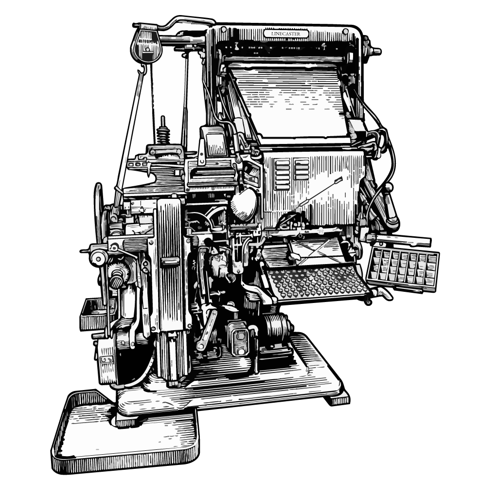

# Linecaster

### Modular OCR pipelines you can run anywhere

<p align="center">
  
</p>
<p align="center"><sub>An Intertype C4 linecaster (1961). Drawing after a photograph in the Science
Museum Group Collection, CC BY-NC-SA 4.0. <a href="#-license">Credit</a></sub></p>

Build an OCR pipeline from interchangeable parts: a model that reads the text, either a vision-language
model or a line recognizer, combined with layout, table and formula models and post-processing. Run
the same pipeline on a laptop, a GPU server, a cluster or [Hugging Face Jobs][HF Jobs].

**Jump to:** [Why](#-why-linecaster) · [Quick start](#-quick-start) · [How it works](#-how-it-works) ·
[Run anywhere](#-run-it-anywhere) · [Outputs](#-what-you-get) ·
[Models and blocks](#-models-and-blocks) · [Reference](#-reference)

## 🤔 Why Linecaster

Turning a scan into usable text takes more than one model. The text has to be read, by a
vision-language model or by a line recognizer. Around that, the layout has to be found, tables and
formulas rebuilt, and the text cleaned, recomposed and written in the formats people use. Every model
comes with its own software, and every machine has its own way of starting and scaling work. Swapping
a model or moving to bigger hardware usually means starting over.

Linecaster keeps the parts and the machines apart:

- 🧩 **Any step.** Reading, layout, lines, tables, formulas and post-processing are separate
  steps. Use a [vision-language model](#-vision-language-models-whole-pages) on whole pages or on layout regions,
  or a [line recognizer](#%EF%B8%8F-recognition) with a line detector, and add any of the other steps.
- 🌍 **Any machine.** Define the pipeline once. Only the line that starts the run changes.
- 🖥️ **No serving stack to build.** Models load inside the pipeline, or each task starts its own model
  server on its GPU.
- 🎯 **The same result everywhere.** A page's text depends only on that page, never on how many
  machines share the work.
- 🔁 **Built for long runs.** Interrupted runs resume. Damaged pages are set aside with the reason.

## 🚀 Quick start

You need Python 3.12 and [uv](https://docs.astral.sh/uv/) 0.13.6 or newer.

```bash
git clone https://github.com/storytracer/linecaster
cd linecaster
```

The quickest start is `launch.py` with a name: a **recipe** (a tested combination of models) or a
**model** that reads whole pages. It knows which pipeline that needs. For your own combination, fill a
pipeline's slots yourself, one preset per step. Either way you get a page record per page in `out/pages`, and
`--files` adds ALTO, PAGE-XML, hOCR, text and Markdown.

```bash
uv run launch.py squiddle scans/ out/          # a recipe
uv run launch.py lightonocr-2-1b scans/ out/   # a model
uv run launch.py                               # lists the recipes and models
```

Every pipeline option works after the name, e.g. `--on hf-jobs` or `--text lines`.

> [!NOTE]
> Each pipeline is a self-contained [uv script][uv scripts]: a `# /// script` block at the top lists
> what it needs, with pinned versions, and a `.lock` file sits next to it. `uv run` installs it on the
> first run; the models download on first use.

### 🍳 A recipe

A recipe is a named combination: a pipeline, a preset edition for each step, and its options, with its own
edition, provenance and evidence. SquiddleOCR's is `squiddle`:

```bash
uv run launch.py squiddle scans/ out/
```

Options after the name change single steps or settings; the run record lists them as overrides.

### 🤖 A vision-language model reads each page

Needs an NVIDIA GPU and the `vllm` command of [vLLM] on the PATH.

```bash
uv run launch.py lightonocr-2-1b scans/ out/
```

Any [model for whole pages](#-models-and-blocks) works. A region model reads each layout region instead,
in the VLM pipeline with a layout preset:
`uv run pipelines/transcribe_vlm.py scans/ out/ --layout pp-doclayoutv3 --recognition minicpm-ocr-1.0`.

### 🧱 The modular pipeline: smaller models, step by step

Layout, line detection and a line recognizer, then post-processing into a document. You pick each
step's preset; `linecaster models` lists them.

```bash
uv run pipelines/transcribe_modular.py scans/ out/ \
  --layout pp-doclayoutv3 \
  --lines pp-ocrv6-medium-det \
  --recognition kraken-ppocrv6-medium \
  --files out/files --formats md,alto
```

Without `--layout` the page is one region; `--tables` and `--formulas` add those steps.
`--set recognition.batch_size=4` changes one option of a preset. `--files` writes any per-page format of
`PageFileWriter` (`--formats`); `--naming squiddleocr --furniture` writes them as squiddleocr does.

### ✍️ Your own pipeline

A pipeline is a list of blocks. This is the modular pipeline above, cut down:

```python
from datatrove.executor import LocalPipelineExecutor
from linecaster.backends import InProcess as P
from linecaster.blocks.composition import (
    Composer, Typographer)
from linecaster.blocks.layout import LayoutDetector
from linecaster.blocks.lines import (
    LineAssigner, LineDetector)
from linecaster.blocks.readers import ImageFolderReader
from linecaster.blocks.recognition import LineRecognizer
from linecaster.blocks.text import UnicodeNormalizer
from linecaster.blocks.writers import PageFileWriter

pipeline = [
    ImageFolderReader("scans/"),
    LayoutDetector(P("linecaster_paddlex:PaddleLayoutEngine")),
    LineDetector(P("linecaster_paddlex:PaddleLineEngine")),
    LineAssigner(),
    LineRecognizer(
        P("linecaster_kraken:KrakenRecognitionEngine")),
    UnicodeNormalizer(),
    Typographer(),
    Composer(),
    PageFileWriter("out/", formats=("md", "alto")),
]
LocalPipelineExecutor(
    pipeline, logging_dir="out/logs").run()
```

Save it in `pipelines/` with the `# /// script` block of `pipelines/transcribe_modular.py` at the top, which brings the
engines, and `uv run` it. Built with `linecaster.runtime.run.main`, as the pipelines are, it gets their command
line for every machine, and a check before anything starts: every block declares what it reads and adds, so a
recognizer without lines or a writer after a server fails at once, with every problem listed. `--dry-run` prints
the plan and its graph as a Mermaid flowchart; `--until`, `--after` and `--tap-after` run or tap a part of it.
`ModularTranscriber` puts layout, lines, line assignment and line recognition together in one block
([docs/reference/pipelines.md](docs/reference/pipelines.md)).

> [!TIP]
> The two kinds mix: a `LayoutDetector` followed by `RegionRecognizer` has a vision-language model read
> each layout region, which is what `pipelines/transcribe_vlm.py --layout …` does.

## 🧩 How it works

Three ideas carry the design:

1. 📋 **One record per page.** Every step reads the page's `Transcription` and adds its part: regions,
   lines, text, tables, a document. Steps never talk to each other, so any step can be replaced.
2. 🔌 **Each model step has a backend.** `InProcess` loads the model inside the pipeline. `Served` sends
   pages to a model server through [saturate], which keeps enough pages in flight that the GPU never
   waits.
3. 🏗️ **The executor decides where it runs.** Pipelines are [datatrove] pipelines. Executors split the
   pages into tasks, run them locally, on a [Ray] cluster or on [Hugging Face Jobs][HF Jobs], and resume
   where a run stopped.

## 🌍 Run it anywhere

A pipeline runs on every machine with the same steps. Only its flags change:

| Where | Flags |
|---|---|
| 💻 This machine | none: the models load inside the pipeline |
| 🖥️ This machine, with a server | `--backend served` |
| 🧮 A Ray cluster | `--on ray --tasks 64` |
| ☁️ Hugging Face Jobs | `--on hf-jobs --commit <sha>` |

On Ray and HF Jobs every task gets one GPU and starts its own model server on it.

<details>
<summary><b>📥 Where the pages come from</b></summary>

The readers follow [datatrove]'s conventions: files found by a glob or listed in a `paths_file`, distributed
over the tasks in turn, with `--limit` and `--skip` per task. Any fsspec path works: local, `s3://`, `hf://`.

| Input | Flags |
|---|---|
| a folder of images | `IMAGES` (`--glob-pattern` to choose files; `--item-from-parent`: the subfolder is the item) |
| a list of images | `IMAGES --paths-file pages.txt` (one image per line, relative to `IMAGES`) |
| Parquet with an image column (pages) | `--parquet PATH` (`--id-key`, `--image-key`, `--item-key`, `--sequence-key`) |
| items' manifests (IIIF, METS) | `--manifests FOLDER`, `--manifests list.txt` (one link per line), or an item table: `--manifests items.parquet --manifest-key manifest_url [--item-key item_id]` |
| page records of an earlier run | `--pages OUT/pages` (images fetched again from their URIs) |

- The image column can hold the bytes, a Hugging Face image struct (`{bytes, path}`), or a path: absolute,
  or relative to `--image-folder`. Without a page-id column, `--item-key` and `--sequence-key` name pages
  `<item>_<0001>`.
- A Hub image dataset is just Parquet: `--parquet hf://datasets/<repo>@<revision>/data`.
- A public bucket needs no credentials with `FSSPEC_S3_ANON=true`.
- **Manifests** (the `pybookget` extra, which brings [pybookget](https://github.com/storytracer/pybookget)):
  a manifest lists an item's pages and their files, in order. Two formats are read, told apart by their
  content (or `--manifest-format`):
  - **IIIF Presentation 2 and 3**: images at full size through the image service (`--iiif-format`), the
    image's own URL after a 404.
  - **METS with MODS**, also inside an OAI-PMH `GetRecord` response (the DFG viewer's profile; Kitodo, Goobi,
    Visual Library): pages from the physical structure map in `ORDER`, images from the first file group of
    `MAX`, `ORIGINAL`, `MASTER`, `DEFAULT` (the next one after a 404). Relative file links are read next to the
    METS file, so a package with local files works too.
  - Each manifest is one item: one reader entry (or one row of an item table), so an item's pages stay in one
    task. Every page with an image becomes `<item>_<0001>`. The item id comes from `--item-key`, else from the
    manifest link's last segment that isn't `manifest`/`mets`; `--item-id-pattern` overrides it.
  - Each page record keeps the item's and the page's data in `metadata.manifest`: format, link, id, label,
    rights, identifiers, descriptive metadata (MODS creators, date, language, …), the page's own id and label.
    An item table's other columns go into each of its pages' metadata.
  - `--existing-ocr` also fetches the library's own OCR the manifest links (METS `FULLTEXT`, IIIF
    `seeAlso`/`rendering`; ALTO or hOCR) and keeps it as the transcription `ocr_original`, next to the new one.
- **http(s):// image URLs** (manifests, or paths in a Parquet column) go through pybookget:
  - retries that honor `Retry-After`, and an honest user agent;
  - the environment's proxy settings (`HTTPS_PROXY`, `HTTP_PROXY`, `ALL_PROXY`, `NO_PROXY`), as everywhere
    else in Linecaster;
  - `--rate-limit 5/1` (repeatable) per task, so the server sees up to `--workers` times that.
- **Harvest, transcribe, bind.** Harvesting first is the usual path, and it keeps the GPUs off the network:
  - `uv run pipelines/harvest.py --manifests items.parquet --manifest-key manifest_url OUT --tasks 16 --workers 4
    --rate-limit 5/1 --existing-ocr` writes `OUT/images/<item>/<page>.<ext>`, `OUT/ocr/…`, the manifests as
    fetched in `OUT/manifests/`, and page records;
  - `uv run pipelines/transcribe_modular.py --pages OUT/pages OUT2 ...` (or `transcribe_vlm.py`) keeps all of it and
    adds the new transcription; `OUT/images --item-from-parent` reads the plain folder instead;
  - `uv run pipelines/bind.py` makes the item texts (below).
  - For small runs, `--manifests` also works directly in the transcribe pipelines.
- **Item-level outputs** (texts per book, issue or manuscript): with several tasks, an item's pages can land in
  different tasks. Item texts are then a second stage:
  - the first run writes its page records into item shards (`--item-shards 64`: `OUT/pages/<shard>/<rank>.jsonl.gz`,
    every item in one shard);
  - `uv run pipelines/bind.py OUT/pages OUT2` reads whole shards, one or more per task, and writes the texts.
  - `--item-texts` in the same run needs a single task.

</details>

<details>
<summary><b>🖥️ A model server that stays up</b></summary>

`serve` starts `linecaster serve` with the presets you name and keeps them loaded; `--endpoint` points
runs at it:

```bash
P="--layout pp-doclayoutv3
   --lines pp-ocrv6-medium-det
   --recognition kraken-ppocrv6-medium"
uv run pipelines/transcribe_modular.py serve $P
uv run pipelines/transcribe_modular.py scans/ out/ $P \
  --endpoint http://127.0.0.1:8100/v1
```

For a vision-language model, `--recognition-endpoint` points `pipelines/transcribe_vlm.py` at a running vLLM or SGLang. The
servers listen on loopback only.

</details>

<details>
<summary><b>🧮 On every GPU, with Ray</b></summary>

`ray` runs Ray's own command line with the pipeline's packages, so every machine has the same Ray and
Linecaster (`$P`: the presets, as above):

```bash
R=pipelines/transcribe_modular.py
uv run $R ray start --head --num-gpus 8
# on each other machine:
# uv run $R ray start --address=<head>:6379
uv run $R scans/ out/ $P --on ray --tasks 64
```

Images and output must be on storage every machine can reach.

</details>

<details>
<summary><b>☁️ On Hugging Face Jobs</b></summary>

One GPU per Job. Each Job installs Linecaster at a pushed commit, with the engines, sources and pins of
the pipeline's `# /// script` block:

```bash
uv run pipelines/transcribe_modular.py \
  s3://bhl-open-data/images \
  hf://buckets/<ns>/<bucket>/<run> $P \
  --paths-file hf://buckets/<ns>/<bucket>/pages.txt \
  --on hf-jobs --commit <sha> \
  --tasks 4000 --workers 64 --item-shards 64 \
  --env FSSPEC_S3_ANON=true
```

- **Tasks and workers:** datatrove hands out the pages over the tasks in turn, and `--workers` Jobs run at the same
  time; the next starts when one finishes.
- **A rerun into the same output** runs only the tasks that didn't finish.
- **`--tasks-per-job`** (datatrove's) lets a single-GPU Job run several tasks one after the other; each task
  starts its own model server.
- **Multi-GPU Jobs:** `--flavor l4x4 --gpus 4` runs four tasks per Job, one per GPU. `pipelines/transcribe_vlm.py` picks the server image
its model was checked with; `--image` names another. `--dry-run` prints the plan and launches nothing.

</details>

<details>
<summary><b>🧱 What the flags do, for your own pipeline</b></summary>

- **Backends:** `InProcess("module:Class", **kwargs)` loads a model inside the pipeline;
  `Served(endpoint, name)` sends pages to a server through [saturate].
- **Server blocks** start a server inside each task and go last in the pipeline, so the server lives
  until every page is written: `ChatModelServer(spec)` starts [vLLM] or [SGLang],
  `ModelServer(MODELS, script=...)` a pipeline's `serve`.
- **Executors:** `LocalPipelineExecutor`, `RayGPUExecutor`, and on HF Jobs `JobsExecutor` (datatrove's
  `JobsPipelineExecutor`, logging JSON lines) or `GPUJobsExecutor` with `dependencies(commit, script)`, which turns
  a script's `# /// script` block into what each Job installs.

`MODELS` names the models a server hosts:

```python
MODELS = [
    {"name": "layout",
     "spec": "linecaster_paddlex:PaddleLayoutEngine"},
    {"name": "recognition",
     "spec": "linecaster_kraken:KrakenRecognitionEngine",
     "kwargs": {"model": "medium"}},
]
```

`linecaster.runtime.run` puts these together for the pipelines.

</details>

## 📦 What you get

| Output | What it is for |
|---|---|
| 📜 Text as printed | checking against a hand-made transcription |
| 📖 Readable text | reading and training: old letterforms folded, hyphens joined, paragraphs flowed |
| 📝 Markdown, HTML, DocLang, [Docling] JSON | documents with headings, tables and formulas |
| 🏛️ [ALTO], [PAGE-XML], [hOCR] | libraries and viewers: every word with its position |
| 🗂️ Page records ([JSON Lines], [Parquet]) | later pipelines: every intermediate result |

Files come per page or, for an item, one per text variant. Word positions need a model that gives them,
such as a line recognizer.

Every run is also traced with [OpenTelemetry]: each task, and one page in a hundred (chosen by page id, so the same
ones every time) plus every page that failed, block by block and into the servers. The traces land in
`OUT/traces/`, and in your own tracing backend when the standard `OTEL_*` variables point to one; nothing is sent
anywhere else. `linecaster traces OUT` says where the time went: per block the time per page, for served blocks
how much of it was the queue and how much the model, the slowest pages, and each task's warm-up
(`--trace-sample 1` traces every page; [docs/reference/tracing.md](docs/reference/tracing.md)).

## 🧰 Models and blocks

Every configuration is a **preset** in Linecaster's catalog: one engine, one model at a pinned revision, and its
settings. The original model card is copied next to it, unchanged, at exactly that revision.
`linecaster models` lists the presets; [docs/catalog](docs/catalog/README.md) has a page for each
engine, model, preset, pipeline and recipe, with the results and where every number comes from.

Vision-language models run behind [vLLM] or [SGLang]. The other models run inside the pipeline or behind
`linecaster serve`, one package per engine: `linecaster-kraken` ([kraken]), `linecaster-paddlex`
([PaddleX]) and `linecaster-tesseract` ([Tesseract]).

<!-- catalog:start -->
### 🗺️ Layout

| Preset | Model |
|---|---|
| [`pp-doclayout-plus-l`](docs/catalog/presets/layout/pp-doclayout-plus-l.md) | [PP-DocLayout_plus-L](https://huggingface.co/PaddlePaddle/PP-DocLayout_plus-L_onnx/tree/feb74619326f634e0e883218598096a3733ad9f7) |
| [`pp-doclayoutv3`](docs/catalog/presets/layout/pp-doclayoutv3.md) | [PP-DocLayoutV3](https://huggingface.co/PaddlePaddle/PP-DocLayoutV3_onnx/tree/46bbdf188bb0a772c08aed74882ce7e51a8f1ea6) |

### 📏 Lines

| Preset | Model |
|---|---|
| [`pp-ocrv6-medium-det`](docs/catalog/presets/lines/pp-ocrv6-medium-det.md) | [PP-OCRv6_medium_det](https://huggingface.co/PaddlePaddle/PP-OCRv6_medium_det_onnx/tree/61323801669c338b7891481ec7bac61ce31b576a) |
| [`pp-ocrv6-small-det`](docs/catalog/presets/lines/pp-ocrv6-small-det.md) | [PP-OCRv6_small_det](https://huggingface.co/PaddlePaddle/PP-OCRv6_small_det_onnx/tree/28fe5895c24fd108c19eb3e8479f4ab385fbfc62) |
| [`pp-ocrv6-tiny-det`](docs/catalog/presets/lines/pp-ocrv6-tiny-det.md) | [PP-OCRv6_tiny_det](https://huggingface.co/PaddlePaddle/PP-OCRv6_tiny_det_onnx/tree/2ba1506c0380b8f0b03dd142459aac66d4421f6c) |

### 👁️ Recognition

| Preset | Model |
|---|---|
| [`kraken-ppocrv6-medium`](docs/catalog/presets/recognition/kraken-ppocrv6-medium.md) | [PP-OCRv6 (medium)](https://huggingface.co/small-models-for-glam/kraken-ppocrv6-medium/tree/f7fd70f3fd22b615f41bada4674ac2462f938339) |
| [`kraken-ppocrv6-small`](docs/catalog/presets/recognition/kraken-ppocrv6-small.md) | [PP-OCRv6 (small)](https://huggingface.co/small-models-for-glam/kraken-ppocrv6-small/tree/49c249bf81d95ab2c5f699638d066f7935da6f16) |
| [`kraken-ppocrv6-tiny`](docs/catalog/presets/recognition/kraken-ppocrv6-tiny.md) | [PP-OCRv6 (tiny)](https://huggingface.co/small-models-for-glam/kraken-ppocrv6-tiny/tree/045d350d5a7664054370539b87bab0e790724ee2) |
| [`lightonocr-2-1b-regions`](docs/catalog/presets/recognition/lightonocr-2-1b-regions.md) | [LightOnOCR-2-1B](https://huggingface.co/lightonai/LightOnOCR-2-1B/tree/c97bd377f04481830395218fa8951df9deaba756) |
| [`minicpm-ocr-1.0`](docs/catalog/presets/recognition/minicpm-ocr-1.0.md) | [MiniCPM-OCR 1.0](https://huggingface.co/openbmb/MiniCPM-OCR-1.0/tree/a59a4acf215e34c6d73149e9eafdb88ed2086e39) |
| [`paddlex-ppocrv6-medium`](docs/catalog/presets/recognition/paddlex-ppocrv6-medium.md) | [PP-OCRv6_medium_rec](https://huggingface.co/PaddlePaddle/PP-OCRv6_medium_rec_onnx/tree/50c7eacafc52fa7bcf4194e8cd08e46f8558504b) |
| [`paddlex-ppocrv6-small`](docs/catalog/presets/recognition/paddlex-ppocrv6-small.md) | [PP-OCRv6_small_rec](https://huggingface.co/PaddlePaddle/PP-OCRv6_small_rec_onnx/tree/b8f84f0b80c529de40b4fbb3544b84fa7233a513) |
| [`paddlex-ppocrv6-tiny`](docs/catalog/presets/recognition/paddlex-ppocrv6-tiny.md) | [PP-OCRv6_tiny_rec](https://huggingface.co/PaddlePaddle/PP-OCRv6_tiny_rec_onnx/tree/2612ab37152ae0a677521bae4e1e3d4fb4cf7c30) |
| [`tesseract-best-eng`](docs/catalog/presets/recognition/tesseract-best-eng.md) | [tessdata_best](https://github.com/tesseract-ocr/tessdata_best/tree/e12c65a915945e4c28e237a9b52bc4a8f39a0cec) |
| [`tesseract-best-latin`](docs/catalog/presets/recognition/tesseract-best-latin.md) | [tessdata_best](https://github.com/tesseract-ocr/tessdata_best/tree/e12c65a915945e4c28e237a9b52bc4a8f39a0cec) |
| [`tesseract-fast-eng`](docs/catalog/presets/recognition/tesseract-fast-eng.md) | [tessdata_fast](https://github.com/tesseract-ocr/tessdata_fast/tree/87416418657359cb625c412a48b6e1d6d41c29bd) |
| [`tesseract-fast-latin`](docs/catalog/presets/recognition/tesseract-fast-latin.md) | [tessdata_fast](https://github.com/tesseract-ocr/tessdata_fast/tree/87416418657359cb625c412a48b6e1d6d41c29bd) |

### 📊 Tables

| Preset | Model |
|---|---|
| [`slanet-plus`](docs/catalog/presets/tables/slanet-plus.md) | [SLANet_plus](https://huggingface.co/PaddlePaddle/SLANet_plus_onnx/tree/7dbe640e127602bf506815e822c09758de73c482) |

### ➗ Formulas

| Preset | Model |
|---|---|
| [`pp-formulanet-l`](docs/catalog/presets/formulas/pp-formulanet-l.md) | [PP-FormulaNet-L](https://huggingface.co/PaddlePaddle/PP-FormulaNet-L_safetensors/tree/69869f2891cc61347d230ef234bcc8b8d297c43a) |
| [`pp-formulanet-plus-l`](docs/catalog/presets/formulas/pp-formulanet-plus-l.md) | [PP-FormulaNet_plus-L](https://huggingface.co/PaddlePaddle/PP-FormulaNet_plus-L_safetensors/tree/6cc004a8e91ea3f3819b05317f40b290cbe99c2b) |

### 🤖 Vision-language models, whole pages

| Preset | Model |
|---|---|
| [`chandra-ocr-2`](docs/catalog/presets/recognition/chandra-ocr-2.md) | [Chandra 2](https://huggingface.co/datalab-to/chandra-ocr-2/tree/af93b47dba1b47b6640c86ccf487ed2260ab9a09) |
| [`deepseek-ocr`](docs/catalog/presets/recognition/deepseek-ocr.md) | [DeepSeek-OCR](https://huggingface.co/deepseek-ai/DeepSeek-OCR/tree/9f30c71f441d010e5429c532364a86705536c53a) |
| [`deepseek-ocr-2`](docs/catalog/presets/recognition/deepseek-ocr-2.md) | [DeepSeek-OCR 2](https://huggingface.co/deepseek-ai/DeepSeek-OCR-2/tree/aaa02f3811945a91062062994c5c4a3f4c0af2b0) |
| [`dots-mocr`](docs/catalog/presets/recognition/dots-mocr.md) | [dots.mocr](https://huggingface.co/rednote-hilab/dots.mocr/tree/e539fbb52280393adc081b289ec597430a0f9031) |
| [`dots-ocr`](docs/catalog/presets/recognition/dots-ocr.md) | [dots.ocr](https://huggingface.co/rednote-hilab/dots.ocr/tree/c0111ce6bc07803dbc267932ffef0ae3a51dc951) |
| [`glm-ocr`](docs/catalog/presets/recognition/glm-ocr.md) | [GLM-OCR](https://huggingface.co/zai-org/GLM-OCR/tree/ca5d8b3e287e52589e37c28385d9655ee4372f9d) |
| [`lightonocr-2-1b`](docs/catalog/presets/recognition/lightonocr-2-1b.md) | [LightOnOCR-2-1B](https://huggingface.co/lightonai/LightOnOCR-2-1B/tree/c97bd377f04481830395218fa8951df9deaba756) |
| [`lightonocr-3-0.8b`](docs/catalog/presets/recognition/lightonocr-3-0.8b.md) | [LightOnOCR-3-0.8B](https://huggingface.co/lightonai/LightOnOCR-3-0.8B/tree/36d8636925327c671bd8e479c517a004f7566bd9) |
| [`lightonocr-3-4b`](docs/catalog/presets/recognition/lightonocr-3-4b.md) | [LightOnOCR-3-4B](https://huggingface.co/lightonai/LightOnOCR-3-4B/tree/b71010f095dc3735de7ee6b9969bff8f8f50b39a) |
| [`nemotron-3.5-parse`](docs/catalog/presets/recognition/nemotron-3.5-parse.md) | [Nemotron 3.5 Parse](https://huggingface.co/nvidia/Nemotron-3.5-Parse/tree/62cb1e4ba153d113ff64aaf2be6e068c377cf53c) |
| [`olmocr-2-7b-1025-fp8`](docs/catalog/presets/recognition/olmocr-2-7b-1025-fp8.md) | [olmOCR-2-7B-1025-FP8](https://huggingface.co/allenai/olmOCR-2-7B-1025-FP8/tree/40bd7202494b8264ee17ada08b401b5aab7a9ce1) |
| [`ovisocr2`](docs/catalog/presets/recognition/ovisocr2.md) | [OvisOCR2](https://huggingface.co/ATH-MaaS/OvisOCR2/tree/65c619d374b55d4152e85150fc1b003700bc1f0c) |
| [`ovisocr3`](docs/catalog/presets/recognition/ovisocr3.md) | [OvisOCR3](https://huggingface.co/ATH-MaaS/OvisOCR3/tree/5f6ce6932efee9ec10c30746db55bd780214b7fd) |
| [`paddleocr-vl-1.6`](docs/catalog/presets/recognition/paddleocr-vl-1.6.md) | [PaddleOCR-VL-1.6](https://huggingface.co/PaddlePaddle/PaddleOCR-VL-1.6/tree/66317acc4c9fc17bd154591ce650735cd2855f3e) |
| [`qianfan-ocr`](docs/catalog/presets/recognition/qianfan-ocr.md) | [Qianfan-OCR](https://huggingface.co/baidu/Qianfan-OCR/tree/623bf5d20d446abdb36606aa4547cd0c18886fe5) |
| [`qwen3.5-9b`](docs/catalog/presets/recognition/qwen3.5-9b.md) | [Qwen3.5-9B](https://huggingface.co/Qwen/Qwen3.5-9B/tree/c202236235762e1c871ad0ccb60c8ee5ba337b9a) |
| [`smoldocling-256m-preview`](docs/catalog/presets/recognition/smoldocling-256m-preview.md) | [SmolDocling-256M-preview](https://huggingface.co/ds4sd/SmolDocling-256M-preview/tree/ce51f56c4ebe36e0b1c3a55f67b261ba22a50bf8) |
| [`unlimited-ocr`](docs/catalog/presets/recognition/unlimited-ocr.md) | [Unlimited-OCR](https://huggingface.co/baidu/Unlimited-OCR/tree/07dea832e22aefee32ad281d4b80551282e1c168) |
| [`unlimited-ocr-2`](docs/catalog/presets/recognition/unlimited-ocr-2.md) | [Unlimited-OCR 2](https://huggingface.co/baidu/Unlimited-OCR-2/tree/9cf077c4b206e0e2a31879df937b0b0bcba3661c) |

### 🍳 Recipes

| Recipe | Pipeline | Presets |
|---|---|---|
| [`squiddle`](docs/catalog/recipes/squiddle.md) | `transcribe_modular.v1` | `pp-doclayoutv3@1`, `pp-ocrv6-medium-det@1`, `kraken-ppocrv6-medium@1`, `slanet-plus@2`, `pp-formulanet-plus-l@1` |
<!-- catalog:end -->

### ✨ Post-processing

These blocks need no model.

| Block | What it does |
|---|---|
| `UnicodeNormalizer` | the text in one Unicode form, [NFC] by default |
| `Typographer` | heading levels from type size, headlines, drop capitals, uncertain page numbers removed |
| `Composer` | composes a page: a [DoclingDocument] per page, lines joined into paragraphs, line-end hyphens removed |
| `BindItem` | binds an item's pages into one DoclingDocument, paragraphs continued across pages |
| `ItemTexts` | one text per item in each [text variant](#-reference) |

### 📥 Input, output and servers

**Readers**

| Block | What it does |
|---|---|
| `ImageFolderReader` | page images from a folder or bucket |
| `ImageParquetReader` | page images from Parquet files with an image column (bytes or a path), e.g. a Hub dataset |
| `PageRecordReader` | page records written by an earlier run |

**Images and checks**

| Block | What it does |
|---|---|
| `ImageFetcher` | loads a page's image again by its address |
| `ImageConverter` | the image as lossless WebP, size checked |
| `PageValidator` | marks invalid pages with the reason, for `rejects/` |

**Writers**

| Block | What it does |
|---|---|
| `PageFileWriter` | one file per page and format: ALTO, PAGE-XML, hOCR, Markdown, text, HTML, DocLang, JSON and more |
| `PageJsonlWriter` | page records as JSON Lines |
| `PageParquetWriter` | page records as Parquet |
| `ItemDocumentWriter` | item documents as Markdown, text, HTML, DocLang, JSON |
| `ItemTextWriter` | item texts as JSON Lines or as files |

**Servers**

| Block | What it does |
|---|---|
| `ChatModelServer` | starts vLLM or SGLang inside a task |
| `ModelServer` | starts `linecaster serve` inside a task |

## 📚 Reference

<details>
<summary><b>📋 The data model</b></summary>

| Class | Holds |
|---|---|
| `Item` | a book, issue, manuscript or file |
| `Page` | one page: its image and named transcriptions |
| `Transcription` | regions, lines and words with positions, reading order and confidences, plus a [DoclingDocument] |
| `Text` | a whole item's text in one version |

- A page can hold several transcriptions side by side, for example the delivered OCR, a new one and the
  ground truth.
- Positions are pixels of the page image; boxes are `[x, y, width, height]`.
- A `Transcription` survives a round trip through JSON exactly, and through ALTO, PAGE-XML and hOCR
  without losing structure, text, positions or confidences.
- [docs/reference/data-model.md](docs/reference/data-model.md) and
  [docs/reference/serialization.md](docs/reference/serialization.md) are the reference.

</details>

<details>
<summary><b>📖 Text variants</b></summary>

Text moves along three independent dimensions, one step at a time:

| Dimension | From | To |
|---|---|---|
| Characters | as written | normalized, expanded, regularized |
| Flow | as laid out | flowed |
| Scope | full page | body text only |

Named variants:

- `verbatim_txt`: as written, as laid out, full page.
- `readable_txt`, `readable_md`: normalized characters, flowed paragraphs, hyphens joined, body text.

All text is Unicode [NFC]. Normalization folds long s, ligatures and r rotunda; it keeps æ, œ, ø and ß.
Spelling is never modernized.

</details>

<details>
<summary><b>🎯 Why results are the same everywhere</b></summary>

- Models batch only the lines of one page, in a fixed order. Pages are never mixed.
- Model revisions are pinned. Numerically relevant library versions are pinned in each pipeline script.
- So a page's output depends on the page and the models, not on the machine, the number of GPUs or what
  else is running.
- Different GPU types can still differ in the last digits of their arithmetic, which causes rare
  one-character differences.

</details>

<details>
<summary><b>🔁 Long runs in stages</b></summary>

- Each stage reads the page records the last one wrote (`PageRecordReader`), adds one part and writes
  complete page records again.
- Originals are never changed.
- A page that fails a check or a step carries the reason; the `RejectWriter` writes it to `rejects/`, later model
  steps pass it by, and too many failures fail the task.
- datatrove keeps logs and completion markers in `logs/`, so finished tasks are skipped on a rerun.

</details>

<details>
<summary><b>🧭 Design principles</b></summary>

- **Every step is replaceable.** Steps share a data model and nothing else.
- **Deployment is not part of the pipeline.** Executors and backends change; steps do not.
- **The text as written is kept.** Readable variants are derived from it and stored next to it.
- **The core stays light.** No machine-learning libraries in the core; engines are separate packages
  that a pipeline installs when it needs them.
- **Readers stay generic.** Folders, buckets, Hugging Face datasets, and the standards for manifests (IIIF,
  METS/MODS). Adapters for one collection or institution belong in the projects that use Linecaster.
- **Open formats out.** ALTO, PAGE-XML, hOCR, text, Markdown, HTML, DocLang, DoclingDocument.

</details>

<details>
<summary><b>📚 The catalog</b></summary>

- **One catalog**, in `src/linecaster/catalog/data/`: models (`models/<id>/model.yaml`, with the upstream
  card in `upstream/<revision>/`), presets by step (`presets/<step>/<id>.yaml`), recipes (`recipes/<id>.yaml`)
  and evidence records (`evidence/*.yaml`). The data is YAML, checked against JSON Schemas generated from the
  code (`src/linecaster/catalog/schemas/`); the reasons are in a Markdown file next to it (`<id>.md`,
  `model.md`).
- **Code has versioned ids.** A preset names its engine (`engine: kraken.recognition.v1`), a recipe its
  pipeline (`pipeline: transcribe_modular.v1`). An incompatible change of options is a new id (`.v2`).
- **Versions:** `version` and `revision` are upstream's, verbatim and exact. A preset or recipe has its
  own integer `edition`, referred to as `id@edition`.
- **Released editions don't change.** `catalog.lock` keeps each released edition's functional content
  and its hash, and `linecaster catalog verify` fails when a released edition changes. Old editions stay
  resolvable.
- **Provenance:** each page file names the presets and revisions that made it (ALTO `Processing`,
  PAGE-XML `MetadataItem`, hOCR metas). Each run writes `OUT/run.yaml` with every block's parameters, preset,
  edition, hash and override, and the pipeline's hash; a run into a folder of another pipeline is refused.
- **Recipes** (`recipes/<id>.yaml`): a pipeline, a preset edition per slot, options. A recipe's hash covers
  its presets' hashes, so one recipe edition pins everything down to the weights.
- **Evidence** records name their source: a Linecaster run, the BHL board, a model card's claim. A whole
  pipeline's results belong to a recipe; a preset's to the preset, with the rest of the pipeline as context.
- [docs/reference/catalog.md](docs/reference/catalog.md) is the full reference.

</details>

<details>
<summary><b>🛠️ Extending Linecaster</b></summary>

| To add | Write |
|---|---|
| a model | `linecaster catalog pin <id> --hf <repo>` for its model entry and card, then a preset (`presets/<step>/<id>.yaml`, its reasons in `<id>.md`) and `linecaster catalog release <id>` |
| a vision-language model | the same, with `engine: chat.v1` and an adapter in `linecaster.adapters.ADAPTERS` if no existing one fits |
| an engine | a class with `engine_id`, `step`, `Options`, `capabilities`, `load()` and `__call__(image, transcription)`, packaged under `engines/` and registered as an entry point (`linecaster.engines`) |
| a recipe | `recipes/<id>.yaml`: a pipeline id, a preset edition per slot, options; then `linecaster catalog release <id>` |
| a processing step | a `PageBlock` with `process_page(doc, page)` |

An engine runs both inside the pipeline and behind `linecaster serve` without further work.

</details>

<details>
<summary><b>🗂️ Repository layout</b></summary>

| Folder | Contents |
|---|---|
| `src/linecaster/` | the data model (`data/`), `formats/`, `text/`, `images/`, the blocks by family (`blocks/`), `backends/`, the server (`serve/`), the catalog, chat `adapters/`, `runtime/` (command line, executors, run record), `tracing/` |
| `src/linecaster/catalog/data/` | the catalog: models with their cards, presets by step, recipes, evidence, `catalog.lock` |
| `engines/` | engine packages: [kraken], [PaddleX], [Tesseract] (code only; their presets are in the catalog) |
| `launch.py` | launches a recipe or a page preset by its name, in the pipeline it needs |
| `pipelines/` | self-contained pipelines that run anywhere and serve their models |
| `tools/` | small utilities, e.g. a GPU probe for HF Jobs |
| `docs/reference/` | reference: glossary, conventions, the data model, serialization, the catalog, pipelines, tracing |
| `docs/` | the generated catalog pages (`docs/catalog/`, one folder per kind of entry), images for this README |

</details>

## 📄 License

The code is Apache-2.0, see [LICENSE](LICENSE).

<details>
<summary><b>🖼️ Image credit</b></summary>

The drawing of the linecaster is by Sebastian Majstorovic, made with Adobe Illustrator and Google
Gemini. It is based on a photograph of the
[Intertype C4 Linecaster](https://collection.sciencemuseumgroup.org.uk/objects/co8407592/intertype-c4-linecaster)
(Intertype Ltd, Slough, 1961; object Y1990.104.12, gift of M.H. Whittaker & Son) in the Science
Museum Group Collection. Photograph © The Board of Trustees of the Science Museum, released under
[CC BY-NC-SA 4.0](https://creativecommons.org/licenses/by-nc-sa/4.0/). The photograph was redrawn as a
black-and-white line drawing.

The drawing is an adaptation of that photograph and is licensed under the same terms,
[CC BY-NC-SA 4.0](https://creativecommons.org/licenses/by-nc-sa/4.0/). It may not be used for
commercial purposes. The Apache-2.0 license of the code does not apply to it. The same credit is in
[docs/LICENSE-linecaster-image.md](docs/LICENSE-linecaster-image.md).

</details>

<!-- links -->
[kraken]: https://github.com/mittagessen/kraken
[PaddleX]: https://github.com/PaddlePaddle/PaddleX
[datatrove]: https://github.com/huggingface/datatrove
[saturate]: https://github.com/davanstrien/saturate
[OpenTelemetry]: https://opentelemetry.io/
[Ray]: https://www.ray.io/
[HF Jobs]: https://huggingface.co/docs/huggingface_hub/guides/jobs
[vLLM]: https://github.com/vllm-project/vllm
[SGLang]: https://github.com/sgl-project/sglang
[Docling]: https://github.com/docling-project/docling
[DoclingDocument]: https://docling-project.github.io/docling/concepts/docling_document/
[ALTO]: https://www.loc.gov/standards/alto/
[PAGE-XML]: https://github.com/PRImA-Research-Lab/PAGE-XML
[hOCR]: https://kba.github.io/hocr-spec/1.2/
[JSON Lines]: https://jsonlines.org/
[Parquet]: https://parquet.apache.org/
[NFC]: https://unicode.org/reports/tr15/
[bhl-ocr-eval]: https://github.com/finebooks/bhl-ocr-eval
[PP-DocLayoutV3]: https://huggingface.co/PaddlePaddle/PP-DocLayoutV3
[PP-DocLayout_plus-L]: https://huggingface.co/PaddlePaddle/PP-DocLayout_plus-L
[PP-OCRv6_tiny_det]: https://huggingface.co/PaddlePaddle/PP-OCRv6_tiny_det
[PP-OCRv6_small_det]: https://huggingface.co/PaddlePaddle/PP-OCRv6_small_det
[PP-OCRv6_medium_det]: https://huggingface.co/PaddlePaddle/PP-OCRv6_medium_det
[kraken-tiny]: https://huggingface.co/small-models-for-glam/kraken-ppocrv6-tiny
[kraken-small]: https://huggingface.co/small-models-for-glam/kraken-ppocrv6-small
[kraken-medium]: https://huggingface.co/small-models-for-glam/kraken-ppocrv6-medium
[SLANet_plus]: https://huggingface.co/PaddlePaddle/SLANet_plus
[PP-LCNet_x1_0_table_cls]: https://huggingface.co/PaddlePaddle/PP-LCNet_x1_0_table_cls
[RT-DETR-L_wired_table_cell_det]: https://huggingface.co/PaddlePaddle/RT-DETR-L_wired_table_cell_det
[RT-DETR-L_wireless_table_cell_det]: https://huggingface.co/PaddlePaddle/RT-DETR-L_wireless_table_cell_det
[PP-FormulaNet_plus-L]: https://huggingface.co/PaddlePaddle/PP-FormulaNet_plus-L
[PP-FormulaNet-L]: https://huggingface.co/PaddlePaddle/PP-FormulaNet-L
[olmOCR-2-7B-1025-FP8]: https://huggingface.co/allenai/olmOCR-2-7B-1025-FP8
[OvisOCR2]: https://huggingface.co/ATH-MaaS/OvisOCR2
[OvisOCR3]: https://huggingface.co/ATH-MaaS/OvisOCR3
[Qianfan-OCR]: https://huggingface.co/baidu/Qianfan-OCR
[Unlimited-OCR]: https://huggingface.co/baidu/Unlimited-OCR
[Unlimited-OCR-2]: https://huggingface.co/baidu/Unlimited-OCR-2
[chandra-ocr-2]: https://huggingface.co/datalab-to/chandra-ocr-2
[DeepSeek-OCR]: https://huggingface.co/deepseek-ai/DeepSeek-OCR
[DeepSeek-OCR-2]: https://huggingface.co/deepseek-ai/DeepSeek-OCR-2
[SmolDocling-256M-preview]: https://huggingface.co/docling-project/SmolDocling-256M-preview
[LightOnOCR-2-1B]: https://huggingface.co/lightonai/LightOnOCR-2-1B
[LightOnOCR-3-0.8B]: https://huggingface.co/lightonai/LightOnOCR-3-0.8B
[LightOnOCR-3-4B]: https://huggingface.co/lightonai/LightOnOCR-3-4B
[Nemotron-3.5-Parse]: https://huggingface.co/nvidia/Nemotron-3.5-Parse
[MiniCPM-OCR-1.0]: https://huggingface.co/openbmb/MiniCPM-OCR-1.0
[PaddleOCR-VL-1.6]: https://huggingface.co/PaddlePaddle/PaddleOCR-VL-1.6
[Qwen3.5-9B]: https://huggingface.co/Qwen/Qwen3.5-9B
[dots.mocr]: https://huggingface.co/dots-studio/dots.mocr
[dots.ocr]: https://huggingface.co/dots-studio/dots.ocr
[GLM-OCR]: https://huggingface.co/zai-org/GLM-OCR
[PP-OCRv6_tiny_rec]: https://huggingface.co/PaddlePaddle/PP-OCRv6_tiny_rec
[PP-OCRv6_small_rec]: https://huggingface.co/PaddlePaddle/PP-OCRv6_small_rec
[PP-OCRv6_medium_rec]: https://huggingface.co/PaddlePaddle/PP-OCRv6_medium_rec
[Tesseract]: https://github.com/tesseract-ocr/tesseract
[tesserocr]: https://github.com/sirfz/tesserocr
[tessdata_best]: https://github.com/tesseract-ocr/tessdata_best
[tessdata_fast]: https://github.com/tesseract-ocr/tessdata_fast
[uv scripts]: https://docs.astral.sh/uv/guides/scripts/
