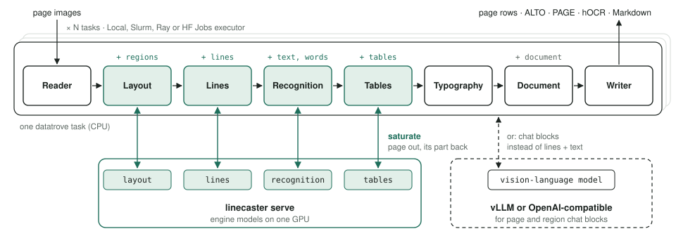

# Linecaster

### Modular OCR pipelines you can run anywhere

<p align="center">
  
</p>
<p align="center"><sub>An Intertype C4 linecaster (1961). Drawing after a photograph in the Science Museum Group
Collection, CC BY-NC-SA 4.0. <a href="#image-credit">Credit</a></sub></p>

Linecaster turns scanned pages into text. You give it a folder of page images; it gives back the text of
every page, a version that is easier to read, and the file formats libraries use.

OCR (optical character recognition) in Linecaster is not one big model. It is a chain of small steps,
each done by its own model or rule: find the text blocks on the page, find the lines, read them, rebuild
the tables, tidy up the text. You can swap any step for a better one and the rest keeps working. The same
chain runs on a laptop or on a hundred GPUs, without changes.

Linecaster is in early development. The ideas below are settled; names and options may still change.

## The problems Linecaster solves

**Much of the text in digital libraries comes from old OCR.** Many collections were scanned and read by
machine years ago, with tools that struggle with old typefaces, tables and unusual layouts. Today's models
read these pages far better, but re-reading millions of pages needs a tool built for that scale: fast,
cheap to run and reliable over weeks.

**OCR tools usually come as one block.** A typical tool bundles finding the layout, finding the lines and
reading them into one package. When a better layout model or a better recogniser appears, you have to
replace the whole tool. In Linecaster each of these is a separate step, so you replace only the step that
got better.

**Classic OCR engines and the new vision-language models live in separate worlds.** They need different
software and give different kinds of output, which makes them hard to compare or combine. Linecaster runs
both in the same kind of pipeline and writes the same records and files for both.

**Results can change from one run to the next.** Many fast setups process pages from different jobs
together, so the text for a page can depend on what else happened to be processed with it. For research,
and for anyone who wants to re-run a collection later, that is a problem. In Linecaster the text for a page
depends only on that page.

**Different readers need different text.** People who measure OCR quality need the text exactly as
printed. Training a language model works better with clean, flowing text. Libraries want standard files
that record where each word sits, so their viewers can highlight search hits on the scan. Linecaster
produces all of these in one run and always keeps the exact text next to the readable one.

**A test on a laptop is far from a run on a whole collection.** A script that works on a hundred pages
often has to be rewritten to run on millions of pages across many machines. In Linecaster the pipeline
stays the same; only the way it is started changes.

**Long runs fail halfway.** Over days or weeks, machines crash and some pages are damaged. Linecaster
records which parts of a run have finished and picks up where it stopped. Damaged pages are set aside with
the reason, and the run carries on.

## Who it is for

- **Libraries and archives** that want better text for collections they have already digitised.
- **Researchers building text datasets**, for example to train language models on historical books.
- **People who develop or compare OCR models**, who need to swap one part and measure the effect.

## What you get

For every page:

- **The text exactly as printed**, line by line, with its original spellings, letterforms and line
  breaks. This is the version to check against a hand-made transcription.
- **A readable version**, where old letterforms such as the long s (ſ) become their modern forms, words
  split by a hyphen at the end of a line are joined again, and lines are joined into paragraphs.
- **Markdown** with headings, tables and formulas.
- **Library formats** (ALTO, PAGE-XML, hOCR) that record where each word sits on the page, so viewers
  can highlight search hits on the scan.
- **One record per page** that keeps every intermediate result, so later work can start where earlier
  work stopped.

For every book, the same text is also joined into one file per version.

## How it works

### Reading a page, step by step

Linecaster reads a page in stages, much as a person would:

1. **Layout:** see where the text blocks, headings, tables, pictures and page numbers are.
2. **Lines:** find each line of text.
3. **Recognition:** read each line, character by character.
4. **Tables:** rebuild tables as rows and columns.
5. **Clean-up:** normalise the characters and remove typesetting debris such as decorative initials.
6. **Document:** put everything together in reading order.

Steps 1 to 4 each use a machine-learning model; the others are plain rules. Each step is a separate
building block, so you can, for example, keep the layout model and try a different recogniser. The blocks
run on [datatrove](https://github.com/huggingface/datatrove), Hugging Face's library for large
data-processing jobs.

### Every step adds to one record

<picture>
  <source media="(prefers-color-scheme: dark)" srcset="docs/architecture-dark.svg">
  
</picture>

*The path of one page. Shaded steps run a model. On the left, what the page's record holds after each
step.*

Each page travels with one record, its `Transcription`, a bit like a form that every step fills in
further. The layout step adds the text blocks, the line step adds the lines, the recogniser adds the text
and the position of each word. Steps never talk to each other directly; they only read and extend this
record. That is why they can be swapped.

A page that fails along the way is not lost. It keeps its error message and skips the remaining model
steps; a check step at the end of the pipeline puts it in a `rejects/` folder together with the reason.

### Where the models run

The models are fastest on a GPU. Linecaster can run them in two ways:

- **Inside the pipeline.** The models load where the pipeline runs. This is the simplest setup, also
  works without a GPU, and is the reference when checking results.
- **On a model server.** `linecaster serve` keeps the models loaded on a GPU, and the pipeline sends
  pages to it. Large vision-language models run the same way, behind a server such as vLLM.

The pipeline talks to its servers through [saturate](https://github.com/davanstrien/saturate), which
keeps enough pages in flight that the GPU never waits. Different steps work on different pages at the
same time: while one page is being read, the layout of the next one is already being found.

### From one machine to many

A pipeline does not change when it grows. datatrove splits the pages into tasks and runs them on one
machine, on a cluster (Ray or Slurm) or on Hugging Face Jobs. It records which tasks have finished, so an
interrupted run picks up where it stopped.

The result for a page depends only on that page, never on what else is running. So a run gives the same
text on one machine or on a hundred.

## Getting started

### Install

linecaster needs Python 3.12 and [uv](https://docs.astral.sh/uv/) 0.13.6 or newer.

```bash
git clone https://github.com/storytracer/linecaster && cd linecaster
uv sync                                  # the core
(cd envs/kraken-paddlex && uv sync)      # an environment with the kraken and PaddleX engines
```

The core has no machine-learning dependencies. The engines bring their own, which often conflict, so
each combination of engines gets its own environment under `envs/`.

### Your first pipeline

This pipeline reads a folder of scans, finds regions and lines, reads the text and writes ALTO and
Markdown files plus one row per page. Run it with the engine environment's Python.

```python
from datatrove.executor import LocalPipelineExecutor

from linecaster.backends import InProcess
from linecaster.blocks.document import AssembleDocument, Typography
from linecaster.blocks.lines import AssignLinesToRegions
from linecaster.blocks.models import LayoutStep, LinesStep, RecognitionStep
from linecaster.blocks.readers import ImageFolderReader
from linecaster.blocks.unicode import NormalizeUnicode
from linecaster.blocks.writers import PageFilesWriter, PageJsonlWriter

pipeline = [
    ImageFolderReader("scans/", item_from_parent=True),      # one subfolder per book
    LayoutStep(InProcess("linecaster_paddlex:PaddleLayoutModel", model_name="PP-DocLayoutV3")),
    LinesStep(InProcess("linecaster_paddlex:PaddleLineModel", model_name="PP-OCRv6_medium_det")),
    AssignLinesToRegions(),
    RecognitionStep(InProcess("linecaster_kraken:KrakenRecognitionModel", model="medium")),
    NormalizeUnicode(),
    Typography(),
    AssembleDocument(),
    PageFilesWriter("out/files", formats=("alto", "md")),
    PageJsonlWriter("out/rows"),
]

LocalPipelineExecutor(pipeline, tasks=4, logging_dir="out/logs").run()
```

### Move the models to a GPU server

Start `linecaster serve` in the engine environment:

```bash
envs/kraken-paddlex/.venv/bin/python -m linecaster.cli serve --port 8100 \
    --model layout=linecaster_paddlex:PaddleLayoutModel --kwargs 'layout={"model_name": "PP-DocLayoutV3"}' \
    --model lines=linecaster_paddlex:PaddleLineModel --kwargs 'lines={"model_name": "PP-OCRv6_medium_det"}' \
    --model recognition=linecaster_kraken:KrakenRecognitionModel --kwargs 'recognition={"model": "medium"}'
```

Then change only the backends. Everything else in the pipeline stays the same:

```python
from linecaster.backends import Served

server = "http://127.0.0.1:8100/v1"
LayoutStep(Served(server, model="layout"))
LinesStep(Served(server, model="lines"))
RecognitionStep(Served(server, model="recognition"))
```

The server can also read its models from a JSON file (`--config models.json`). It listens on loopback
only, unless you tell it otherwise.

### Read pages with a vision-language model

`ChatPageStep` sends whole pages to an OpenAI-compatible server. `ChatRegionStep` sends one crop per
layout region instead. A short model spec in `linecaster.models` holds the model's prompt, sampling,
server flags and how to read its answer:

```python
from linecaster.blocks.chat import ChatPageStep
from linecaster.models import chat_model

spec = chat_model("lightonai/LightOnOCR-2-1B")
ChatPageStep(spec, Served("http://127.0.0.1:8000/v1", model=spec.model))
```

### Run on Hugging Face Jobs

With one GPU per Job, each Job starts its own model server. Put the server block last in the pipeline,
so the server stays up until every page is written:

```python
from datatrove.executor import JobsPipelineExecutor
from linecaster.blocks.serve import ServeModels
from linecaster.jobs import dependencies

pipeline = [..., PageJsonlWriter("hf://buckets/<namespace>/<bucket>/run/rows"), ServeModels(models, port=8100)]
JobsPipelineExecutor(pipeline, tasks=16, flavor="l4x1", dependencies=dependencies("<pushed commit>"),
                     logging_dir="hf://buckets/<namespace>/<bucket>/run/logs").run()
```

`ServeChatModel` does the same for vLLM. On machines with several GPUs, `GPUJobsExecutor` runs one task
per GPU. `recipes/hf-jobs/` has complete examples.

### Run on a Ray cluster

Start Ray on every machine, then run the pipeline once from any of them. Each task gets one GPU and starts
its own model server on it:

```bash
uv sync --extra ray
.venv/bin/ray start --head --num-gpus 8          # other machines: ray start --address=<head>:6379
.venv/bin/python recipes/ray/squiddle_chain.py IMAGES OUT --tasks 64
```

The page images and the output folder must be reachable from every machine.

### Split long runs into stages

A large job is easier to run, check and repeat in stages. Each stage reads the page rows the previous
one wrote (`PageRowReader`), adds one part and writes complete rows again. The original files are never
changed; rejected pages and their reasons go to `rejects/`, and datatrove's logs and completion markers
go to `logs/`.

## Under the hood

### The data model

| Class | What it holds |
|---|---|
| `Item` | a multi-page unit: book, issue, manuscript, file |
| `Page` | one page: its image and any number of named transcriptions |
| `Transcription` | regions, lines and words with positions, reading order and confidences, plus a DoclingDocument |
| `Text` | the text of a whole item in one variant |

A page can hold several transcriptions side by side, for example a delivered OCR text, a new
recognition and the ground truth.

Positions are pixels of the page image. Boxes are `[x, y, width, height]`; polygons and baselines are
lists of points. A `Transcription` survives a round trip through JSON exactly, and through ALTO,
PAGE-XML and hOCR without losing structure, text, positions or confidences. `specs/` describes the
design in full.

### Text variants

linecaster describes text along three independent axes. Each transform moves one step on one axis and
leaves the others alone.

| Axis | From | To |
|---|---|---|
| Characters | as written | normalised, expanded, regularised |
| Flow | as laid out | flowed |
| Scope | full page | body text only |

Three combinations have names:

- `verbatim_txt`: as written, as laid out, the full page.
- `readable_txt` and `readable_md`: normalised characters, flowed paragraphs with hyphens joined, body
  text only.

All text is in Unicode NFC. Normalisation folds typographic forms such as long s, ligatures and
r rotunda, and keeps letters such as æ, œ, ø and ß. Spelling is never modernised.

## Design principles

- **Every step is replaceable.** Steps share a data model and nothing else.
- **The text as written is kept.** Readable versions are derived from it and stored next to it.
- **Results are reproducible.** A page's output depends only on the page and the pinned models.
- **Scaling belongs to the executor.** The pipeline stays the same from one machine to many.
- **The core stays light.** Engines are separate packages with their own environments.
- **Connectors stay generic.** Folders, buckets and Hugging Face datasets are built in. Adapters for a
  particular collection or institution belong in the projects that use linecaster.
- **Open formats out.** ALTO, PAGE-XML, hOCR, plain text, Markdown and DoclingDocument.

## Extending linecaster

- **A new engine model** is a class with `step`, `name`, `load()` and
  `__call__(image, transcription, **params) -> Transcription`. Package it under `backends/` and it runs
  in-process and behind `linecaster serve`.
- **A new vision-language model** is a `ChatModel` subclass with the model id, revision, sampling,
  server flags, `request()` and the parsing of its answer. Register it in `linecaster.models`.
- **A new processing step** is a `PageStep`: implement `process_page(doc, page)` and return the page.

## Repository layout

```
src/linecaster/        data model, blocks, model server, model specs, Jobs helpers
backends/              engine packages (linecaster-kraken, linecaster-paddlex)
envs/                  environments that install engines together
examples/, recipes/    complete pipelines, local and on Hugging Face Jobs
specs/                 design of the data model and the serialisers
docs/                  images for this README
```

## Licence

The code is licensed under Apache-2.0, see [LICENSE](LICENSE). The drawing in `docs/linecaster.png`
has its own licence, below.

### Image credit

The drawing of the linecaster is by Sebastian Majstorovic, made with Adobe Illustrator and Google
Gemini. It is based on a photograph of the
[Intertype C4 Linecaster](https://collection.sciencemuseumgroup.org.uk/objects/co8407592/intertype-c4-linecaster)
(Intertype Ltd, Slough, 1961; object Y1990.104.12, gift of M.H. Whittaker & Son) in the Science
Museum Group Collection. Photograph © The Board of Trustees of the Science Museum, released under
[CC BY-NC-SA 4.0](https://creativecommons.org/licenses/by-nc-sa/4.0/). The photograph was redrawn as a
black-and-white line drawing.

The drawing is an adaptation of that photograph and is licensed under the same terms,
[CC BY-NC-SA 4.0](https://creativecommons.org/licenses/by-nc-sa/4.0/). It may not be used for
commercial purposes. The Apache-2.0 licence of the code does not apply to it.
