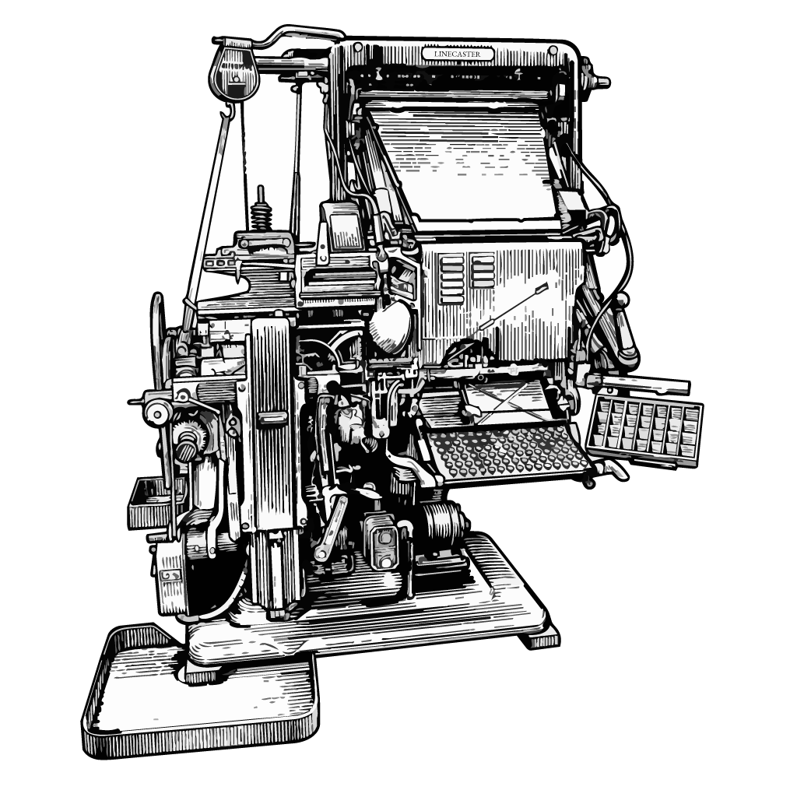
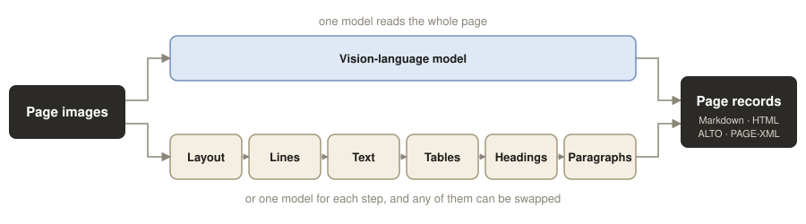

# Linecaster

### Modular OCR pipelines you can run anywhere

<p align="center">
  
</p>
<p align="center"><sub>An Intertype C4 linecaster (1961), after a photograph in the Science Museum Group
Collection, CC BY-NC-SA 4.0. <a href="#license">Credit</a></sub></p>

Linecaster turns page images into text, with any OCR model, on any machine, and tells you how good the result is.

## The problem

There are dozens of good OCR models: classic engines that read line by line, and vision-language models that read
a whole page. Each comes with its own installation, its own input and output formats and its own scripts. That
makes four things harder than they should be:

- **Trying another model** means writing new glue code, so most projects stay with the first model that worked.
- **Combining models**, such as one model's layout with another model's text recognition, is not possible at all
  with most tools.
- **Going from ten pages to ten million** means rewriting the same job for a cluster.
- **Knowing which setup is best** for your material needs ground truth and a fair comparison, which few tools
  include.

Linecaster puts every model behind the same few options and every result into the same record. You change a
model by changing one word, you run the same pipeline on a laptop or a cluster, and you score the result against
ground truth.

<p align="center">
  
</p>

## What it does

| | | |
|---|---|---|
| 📥 | **Harvest** | Fetch page images from IIIF and METS manifests, with rate limits, proxies and resume |
| 🖼️ | **Convert** | Convert page images to JPEG, JPEG 2000, PNG or WebP, on the GPU where there is one |
| 🤖 | **Read with a vision-language model** | Models that read a whole page in one go, served by [vLLM] or [SGLang] |
| 🧩 | **Read step by step** | Layout, lines, text, tables and formulas, each by a model you pick: [PaddleX], [kraken], [Tesseract] |
| 🧱 | **Structure** | Headings and their levels, paragraphs, and a document per page |
| 📚 | **Bind** | Join pages into books and issues, with one text per item |
| 📝 | **Write** | Markdown, HTML, plain text and JSON; [ALTO], [PAGE-XML] and [hOCR] with every word's position |
| 🔤 | **Keep the text as read** | The stored text is exactly what the model read; every change is a rule you name |
| 🎓 | **Import ground truth** | ALTO, PAGE-XML, hOCR, TEI, HTML and plain text, read into the same records |
| 🎯 | **Score** | Character and word error rates with confidence intervals, for pages, tables and formulas |
| 🌍 | **Run anywhere** | A laptop, a GPU server, Ray, Slurm or [Hugging Face Jobs][HF Jobs]: the pipeline stays the same |
| 🔁 | **Survive long runs** | An interrupted run resumes; a page that fails is set aside with the reason |
| 🔎 | **Trace everything** | Each result names the model that made it; each run records its models, settings and versions |

**Documentation:** [storytracer.github.io/linecaster](https://storytracer.github.io/linecaster/)

## Quick start

You need Python 3.12 and [uv](https://docs.astral.sh/uv/) 0.13.6 or newer. An NVIDIA GPU is recommended.

```bash
git clone https://github.com/storytracer/linecaster
cd linecaster
```

There is nothing to install. Every pipeline is a [uv script][uv scripts] with pinned dependencies, which `uv run`
installs on the first run. Models download on first use.

The three examples below go from simple to flexible: one model for the whole page, a model for each step, and a
tested combination under a name.

## 1. One model reads the page

A vision-language model reads a whole page in one request, so there is one model to pick. It runs behind [vLLM]
or [SGLang], which needs an NVIDIA GPU and the `vllm` command on the `PATH`:

```bash
uv run pipelines/transcribe_vlm.py scans/ out/ --recognition lightonocr-2-1b
```

This reads the images in `scans/` and writes:

| In `out/` | What it is |
|---|---|
| `pages/` | one page record per page: the text the model read, with the model's raw answer |
| `rejects/` | pages that failed, each with the reason |
| `run.yaml` | the run record: what ran, with which models and versions |

`uv run linecaster presets --step recognition` lists the models. Tutorial:
[Run a vision-language model](docs/start/vlm.md).

## 2. A model for each step

The modular pipeline divides the work into steps, and each option names a **preset**: a model at a pinned
revision with its settings.

```bash
uv run pipelines/transcribe_modular.py scans/ out/ \
  --layout pp-doclayoutv3 \
  --lines pp-ocrv6-medium-det \
  --recognition paddlex-ppocrv6-medium \
  --document linked-document \
  --files out/files --formats md,html
```

This also writes a Markdown and an HTML file for each page to `out/files/`.

To swap a model, change one option. This run keeps the layout and the lines and reads the text with Tesseract:

```bash
uv run pipelines/transcribe_modular.py scans/ out-tesseract/ \
  --layout pp-doclayoutv3 \
  --lines pp-ocrv6-medium-det \
  --recognition tesseract-best-latin \
  --document linked-document \
  --files out-tesseract/files --formats md,html
```

More steps are more options:

| Option | Step |
|---|---|
| `--layout` | the regions of a page and their order (`single-region`: the whole page, no layout model) |
| `--lines` | the lines |
| `--recognition` | the text of each line |
| `--tables` | table cells |
| `--formulas` | formulas as LaTeX (its model needs torch: run it in a script that installs torch, as a recipe's does) |
| `--hierarchy` | headings and their levels |
| `--paragraphs` | lines joined into paragraphs |
| `--document` | the page as a document, which Markdown, HTML and JSON are written from |

No step has a default, so a run always names what it ran. `--set recognition.batch_size=4` changes one setting
of a preset, `--dry-run` prints the plan and runs nothing, and `--help` lists everything else.

Tutorial: [Combine models step by step](docs/start/first-run.md).

### The same in Python

A `Pipeline` is a list of components, one for each thing that happens to a page. Save this as a script and run
it with `uv run`:

```python
# /// script
# requires-python = ">=3.12,<3.13"
# dependencies = ["linecaster", "linecaster-paddlex"]
#
# [tool.uv.sources]
# linecaster = { git = "https://github.com/storytracer/linecaster", branch = "main" }
# linecaster-paddlex = { git = "https://github.com/storytracer/linecaster", branch = "main", subdirectory = "engines/paddlex" }
# ///
from linecaster import Pipeline
from linecaster.components.document import DocumentComposer
from linecaster.components.hierarchy import HierarchyDetector
from linecaster.components.layout import LayoutDetector
from linecaster.components.lines import LineAssigner, LineDetector
from linecaster.components.paragraphs import ParagraphBuilder
from linecaster.components.readers import ImageFolderReader
from linecaster.components.recognition import LineRecognizer
from linecaster.components.writers import PageFileWriter, PageJsonlWriter

pipeline = Pipeline([
    ImageFolderReader("scans/"),
    LayoutDetector("pp-doclayoutv3"),
    LineDetector("pp-ocrv6-medium-det"),
    LineAssigner(),
    LineRecognizer("paddlex-ppocrv6-medium"),
    HierarchyDetector("ratios"),
    ParagraphBuilder("unicode-paragraphs"),
    DocumentComposer("linked-document"),
    PageJsonlWriter("out/pages"),
    PageFileWriter("out/files", formats=("md", "html")),
])
pipeline.run("out")
```

Every component declares what it reads and what it adds. `run` checks these declarations first, so a pipeline
that cannot work stops before it starts: a recognizer without a line detector fails at once, with the reason.
`pipeline.draw()` gives the pipeline's graph, and `pipeline.to_dict()` the pipeline as plain data.

Tutorial: [A pipeline in Python](docs/start/python.md).

## 3. A recipe

A **recipe** is a tested combination kept under a name: one preset for each step, and the texts to write. A
recipe has a script of its own with exactly the engines it needs, and `launch.py` runs it by name:

```bash
uv run launch.py                          # list the recipes
uv run launch.py squiddle scans/ out/     # run one
```

Options after the name replace single steps, and the run record lists what was changed. A recipe's script also
runs from its URL, without a checkout:

```bash
uv run https://raw.githubusercontent.com/storytracer/linecaster/main/recipes/squiddle.py scans/ out/
```

## Input and output

| Pages from | Options |
|---|---|
| a folder of images | `IMAGES` (with `--item-from-parent`, each subfolder is an item) |
| a list of images | `IMAGES --paths-file pages.txt` |
| Parquet with an image column | `--parquet PATH` |
| IIIF or METS manifests | `--manifests FOLDER`, or a list or a Parquet table of their URLs |
| an earlier run | `--pages OUT/pages` |

Paths can be local or remote: `s3://`, `hf://`, `http(s)://` and every other [fsspec] protocol.

| Output | Option |
|---|---|
| page records, as JSON Lines or Parquet | always, in `OUT/pages/` |
| Markdown, HTML, plain text and JSON per page | `--files DIR --formats md,html,txt,json`, with `--document` |
| ALTO, PAGE-XML and hOCR, with every word's position | `--files DIR --formats alto,page,hocr` |
| one text per book or issue | `--item-texts DIR --text literal:txt`, with `--document` |

The stored text is exactly what the model read. Joining divided words, folding historic letterforms and similar
changes are made only in a text you ask for, by rules you name: `--text latin-historic+flow:md`.
[Text and normalization](docs/concepts/text.md) explains why.

## Run anywhere

| Where | Options |
|---|---|
| this machine | none: the models load inside the pipeline |
| this machine, with a model server | `--backend served` |
| a Ray cluster | `--on ray --tasks 64` |
| Hugging Face Jobs | `--on hf-jobs --namespace NS --commit <sha>` |
| a Slurm cluster | from Python, with [datatrove]'s Slurm executor |

Linecaster builds on [datatrove], which divides the pages into tasks and resumes a run where it stopped.
[Running at scale](docs/reference/running.md) has the setup for each of these, and for collections that are
fetched first and transcribed later.

## Score a run

Ground truth is read into the same page records as a run's output, so the two can be compared:

```bash
uv run pipelines/import_transcriptions.py truth/ --parquet ocr.parquet --data-key alto --importer alto-import
uv run linecaster benchmark init truth/pages benchmark.yaml
uv run linecaster score out/ truth/pages --benchmark benchmark.yaml
```

The result is an evidence record: error rates with their confidence intervals, and exactly how they were
measured. Tutorial: [Score a run against ground truth](docs/start/score.md).

## How it works

| Term | Meaning |
|---|---|
| component | does one thing to a page: finds the lines, reads them, writes a file |
| step | one kind of work: `layout`, `lines`, `recognition`, `tables`, `formulas`, `hierarchy`, `paragraphs`, `document` |
| engine | the code that runs a model: one package per OCR library (`linecaster-paddlex`, `linecaster-kraken`, `linecaster-tesseract`, ...) |
| preset | an engine, a model at a pinned revision and settings, under one name; what you pick for a step |
| recipe | a tested set of presets, one for each step |
| page record | everything the components found on one page, each finding with the model that made it |
| run record | what a run ran: every preset with its hash, and the versions |

A component adds to the page record and never overwrites what is there. Files and texts are written from the
record, so one run can serve Markdown to a reader and ALTO to a library. The
[overview](docs/concepts/overview.md) explains these ideas in a few minutes.

## Documentation

| | |
|---|---|
| Get started | [Run a vision-language model](docs/start/vlm.md), [Combine models step by step](docs/start/first-run.md), [A pipeline in Python](docs/start/python.md), [Score a run](docs/start/score.md) |
| Concepts | [Overview](docs/concepts/overview.md), [components and pipelines](docs/concepts/pipelines.md), [models, engines and presets](docs/concepts/models.md), [page records](docs/concepts/page-records.md), [text and normalization](docs/concepts/text.md), [evaluation](docs/concepts/evaluation.md) |
| Look up | [every component](https://storytracer.github.io/linecaster/latest/components/), [every preset, model and recipe](https://storytracer.github.io/linecaster/latest/catalog/), the [glossary](docs/reference/glossary.md) |
| Reference | [architecture](docs/reference/architecture.md), [pipelines](docs/reference/pipelines.md), [data model](docs/reference/data-model.md), [serialization](docs/reference/serialization.md), [catalog files](docs/reference/catalog.md), [evaluation](docs/reference/evaluation.md) |
| Operations | [running at scale](docs/reference/running.md), [fetching over HTTP](docs/reference/http.md), [broker](docs/reference/broker.md), [tracing](docs/reference/tracing.md) |
| Contributing | [conventions](docs/reference/conventions.md), [compatibility and releases](docs/reference/compatibility.md) |

For coding agents, the site has an [`llms.txt`](https://storytracer.github.io/linecaster/latest/llms.txt).

## Versions

The current release is `v0.13.1`. [CHANGELOG.md](CHANGELOG.md) lists each release's changes, upgrade notes
first. While the version is 0.x, a release that breaks something raises the minor version and names what to
change ([versions and releases](docs/reference/compatibility.md#versions-and-releases)).

## License

The code is Apache-2.0, see [LICENSE](LICENSE).

<details>
<summary><b>Image credit</b></summary>

The drawing of the linecaster is by Sebastian Majstorovic, made with Adobe Illustrator and Google Gemini. It is
based on a photograph of the
[Intertype C4 Linecaster](https://collection.sciencemuseumgroup.org.uk/objects/co8407592/intertype-c4-linecaster)
(Intertype Ltd, Slough, 1961; object Y1990.104.12, gift of M.H. Whittaker & Son) in the Science Museum Group
Collection. Photograph © The Board of Trustees of the Science Museum, released under
[CC BY-NC-SA 4.0](https://creativecommons.org/licenses/by-nc-sa/4.0/), redrawn as a black-and-white line drawing.

The drawing is an adaptation of that photograph and is licensed under the same terms,
[CC BY-NC-SA 4.0](https://creativecommons.org/licenses/by-nc-sa/4.0/). It may not be used for commercial
purposes. The Apache-2.0 license of the code does not apply to it. The same credit is in
[docs/LICENSE-linecaster-image.md](docs/LICENSE-linecaster-image.md).

</details>

<!-- links -->
[kraken]: https://github.com/mittagessen/kraken
[PaddleX]: https://github.com/PaddlePaddle/PaddleX
[Tesseract]: https://github.com/tesseract-ocr/tesseract
[datatrove]: https://github.com/huggingface/datatrove
[fsspec]: https://filesystem-spec.readthedocs.io/
[HF Jobs]: https://huggingface.co/docs/huggingface_hub/guides/jobs
[vLLM]: https://github.com/vllm-project/vllm
[SGLang]: https://github.com/sgl-project/sglang
[ALTO]: https://www.loc.gov/standards/alto/
[PAGE-XML]: https://github.com/PRImA-Research-Lab/PAGE-XML
[hOCR]: https://kba.github.io/hocr-spec/1.2/
[JSON Lines]: https://jsonlines.org/
[Parquet]: https://parquet.apache.org/
[uv scripts]: https://docs.astral.sh/uv/guides/scripts/
