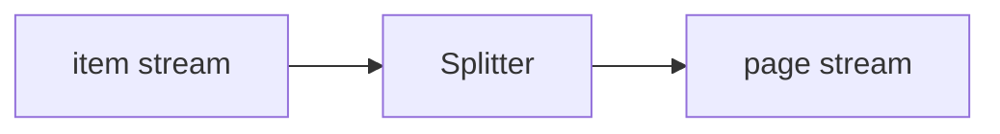

<!-- Generated by `linecaster docs`: edit the code, the docstrings or the catalog, not this file. -->
# Splitter

*Block · binding · `linecaster.blocks.binding`*

Splits each item record into its page records again, in the item's order, with what the item-level blocks added.

|  |  |
|---|---|
| Unit | item → page |
| Role | splitter |
| Reads | - |
| Adds | - |
| Replaces | - |
| Comes after | - |
| Comes before | - |
| Used in | - |
| Source | [splitter.py](https://github.com/storytracer/linecaster/blob/main/src/linecaster/blocks/binding/splitter.py) |

The comes-after and comes-before rows are derived from every block's contract.

## Options

| Option | Type | Default | Description |
|---|---|---|---|
| `primary` | `str` | `'ocr_new'` | the transcription whose text becomes each page document's `text`. |

## Behavior

Each page is a page document again (`doc.id` the page id, `doc.metadata["page"]`, `doc.text` the text of
`primary`) carrying what the item-level blocks added to it: the paragraphs of an item-level `Recomposer`
(continued across pages, the references naming the other page), the normalized texts, the step records. It
changes the stream's unit from items to pages. The item's own parts (its `document`) stay with the item; the
pages carry no image bytes (`PageRecordReader` fetches them again by URI). A stream entry that is no item
record is counted (`no_item`) and not passed on.

## Contract

