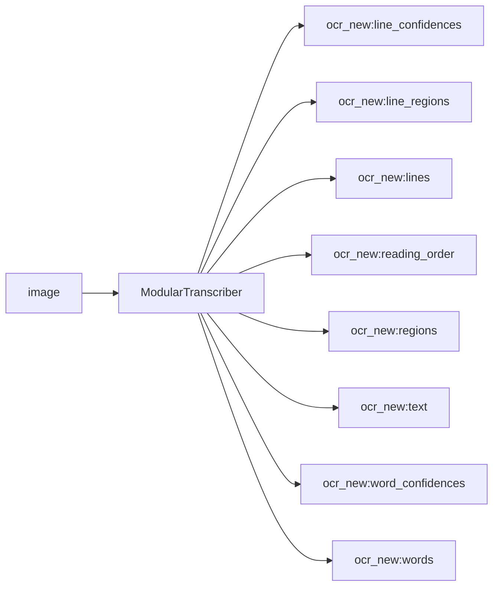

<!-- Generated by `linecaster docs`: edit the code, the docstrings or the catalog, not this file. -->
# ModularTranscriber

*Block · composites · `linecaster.blocks.composites`*

Reads a page's lines the modular way: layout, lines on the whole page, line assignment, line recognition.

|  |  |
|---|---|
| Unit | page |
| Role | composite |
| Reads | `image` |
| Adds | `ocr_new:line_confidences`, `ocr_new:line_regions`, `ocr_new:lines`, `ocr_new:reading_order`, `ocr_new:regions`, `ocr_new:text`, `ocr_new:word_confidences`, `ocr_new:words` |
| Replaces | - |
| Comes after | any reader |
| Comes before | [`LineAssigner`](../lines/LineAssigner.md), [`FormulaRecognizer`](../recognition/FormulaRecognizer.md), [`LineRecognizer`](../recognition/LineRecognizer.md), [`RegionRecognizer`](../recognition/RegionRecognizer.md), [`TableRecognizer`](../recognition/TableRecognizer.md), [`CharacterNormalizer`](../text/CharacterNormalizer.md), [`UnicodeNormalizer`](../text/UnicodeNormalizer.md), [`Composer`](../composition/Composer.md), [`Recomposer`](../composition/Recomposer.md), [`Typographer`](../composition/Typographer.md), [`ItemTextWriter`](../writers/ItemTextWriter.md), [`PageFileWriter`](../writers/PageFileWriter.md) |
| Used in | [`transcribe_modular.v1`](../../catalog/pipelines/transcribe_modular.v1.md) |
| Source | [modular.py](https://github.com/storytracer/linecaster/blob/main/src/linecaster/blocks/composites/modular.py) |

The contract is that of `ModularTranscriber(lines='pp-ocrv6-medium-det@1', recognition='kraken-ppocrv6-medium@1', layout='pp-doclayoutv3@1')`; the comes-after and comes-before rows are derived from every block's contract.

## Options

| Option | Type | Default | Description |
|---|---|---|---|
| `lines` |  | required | a `LineDetector`, its backend, or a lines preset's ref. |
| `recognition` |  | required | a `LineRecognizer`, its backend, or a recognition preset's ref. |
| `layout` |  | required | a `LayoutDetector`, its backend, or a layout preset's ref; `"single-region@1"` reads the page as one region. |
| `formulas_separately` | `bool` | `False` | formula regions take no lines, for a formula step after it. |
| `transcription` | `str` | `'ocr_new'` | the transcription every step works on (blocks given as blocks keep their own). |
| `name` | `str` | `'modular transcriber'` | the composite's name in the graph and the plan. |

## Behavior

Expands into a `LayoutDetector`, a `LineDetector`, a `LineAssigner` and a `LineRecognizer`, each model
step with its own engine and backend, in the transcription `transcription`. Outward contract: reads the page
image; adds regions, reading order, lines, their assignment to regions and the recognizer's parts (text,
words, confidences: its preset's).

## Contract



## Example

```python
ModularTranscriber("pp-ocrv6-medium-det@1", "kraken-ppocrv6-medium@1", layout="pp-doclayoutv3@1")
```
