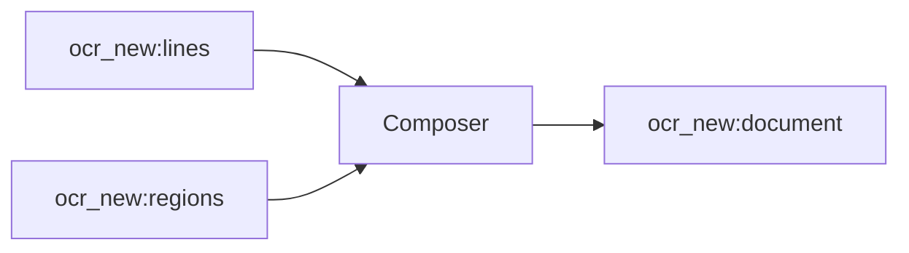

<!-- Generated by `linecaster docs`: edit the code, the docstrings or the catalog, not this file. -->
# Composer

*Block · composition · `linecaster.blocks.composition`*

Composes the DoclingDocument of a page or an item by a composition engine.

|  |  |
|---|---|
| Unit | page |
| Role | transform |
| Reads | `ocr_new:lines`, `ocr_new:regions` |
| Adds | `ocr_new:document` |
| Replaces | - |
| Backends | in-process only (a built-in engine) |
| Catalog step | `composition` |
| Presets | [`docling-composition@1`](../../catalog/presets/composition/docling-composition.md) |
| Comes after | [`LayoutDetector`](../layout/LayoutDetector.md), [`LineDetector`](../lines/LineDetector.md), [`RegionRecognizer`](../recognition/RegionRecognizer.md), [`ModularTranscriber`](../composites/ModularTranscriber.md) |
| Comes before | [`ItemDocumentWriter`](../writers/ItemDocumentWriter.md) |
| Used in | [`bind.v1`](../../catalog/pipelines/bind.v1.md), [`transcribe_modular.v1`](../../catalog/pipelines/transcribe_modular.v1.md) |
| Source | [composer.py](https://github.com/storytracer/linecaster/blob/main/src/linecaster/blocks/composition/composer.py) |

The contract is that of `Composer(preset='docling-composition@1')`; the comes-after and comes-before rows are derived from every block's contract.

## Options

| Option | Type | Default | Description |
|---|---|---|---|
| `preset` |  | required | the composition engine: a preset (e.g. `docling-composition@1`) or an `InProcess` engine spec. |
| `transcription` | `str` | `'ocr_new'` | the transcription to compose. |
| `unit` | `str` | `'page'` | `page` (a document per page) or `item` (a document per item record, after a `Binder`). |
| `options` | `dict[str, Any] \| None` | `None` | engine options over the preset's, e.g. `{"sections": True}`; `None`: the preset's. |

## Behavior

Text regions are composed from their paragraphs when a `Recomposer` made them, else from their lines as laid
out (a diplomatic document). Reads `regions` and `lines` (and the paragraphs when there are); adds
`document`; stat `documents` (pages) or `items`.

`unit="page"`: one document per page, named after the page id, in the transcription's `docling`; the map
from each Docling item to its layout region (`"<page_no>:<region id>"`) in
`transcription.extra["docling_region_of"]`, for the Markdown dividers of the page writers.
`unit="item"`: one document per item record (`linecaster.blocks.base.item`), page `n` its `n`-th
page, paragraphs continued across pages (an item-level `Recomposer` before it): `doc.metadata["docling"]`,
`["region_of"]` and `["item_id"]`, `doc.text` its plain text (with furniture), as `ItemDocumentWriter`
writes them. Each page's transcription records the step.

## Contract



## Example

```python
Composer("docling-composition@1")
Composer("docling-composition@1", unit="item")
```
