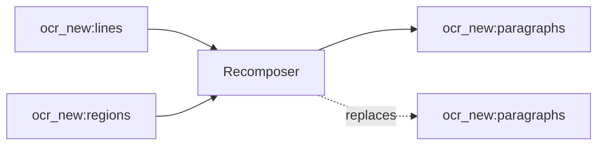

<!-- Generated by `linecaster docs`: edit the code, the docstrings or the catalog, not this file. -->
# Recomposer

*Block · composition · `linecaster.blocks.composition`*

Recomposes the running text of a page or an item into paragraphs by a recomposition engine.

|  |  |
|---|---|
| Unit | page |
| Role | transform |
| Reads | `ocr_new:lines`, `ocr_new:regions` |
| Adds | `ocr_new:paragraphs` |
| Replaces | `ocr_new:paragraphs` |
| Backends | in-process only (a built-in engine) |
| Catalog step | `recomposition` |
| Presets | [`unicode-recomposition@1`](../../catalog/presets/recomposition/unicode-recomposition.md) |
| Comes after | [`LayoutDetector`](../layout/LayoutDetector.md), [`LineDetector`](../lines/LineDetector.md), [`RegionRecognizer`](../recognition/RegionRecognizer.md), [`ModularTranscriber`](../composites/ModularTranscriber.md) |
| Comes before | [`ItemTextWriter`](../writers/ItemTextWriter.md) |
| Used in | [`bind.v1`](../../catalog/pipelines/bind.v1.md), [`transcribe_modular.v1`](../../catalog/pipelines/transcribe_modular.v1.md) |
| Source | [recomposer.py](https://github.com/storytracer/linecaster/blob/main/src/linecaster/blocks/composition/recomposer.py) |

The contract is that of `Recomposer(preset='unicode-recomposition@1')`; the comes-after and comes-before rows are derived from every block's contract.

## Options

| Option | Type | Default | Description |
|---|---|---|---|
| `preset` |  | required | the recomposition engine: a preset (e.g. `unicode-recomposition@1`) or an `InProcess` engine spec. |
| `transcription` | `str` | `'ocr_new'` | the transcription to recompose. |
| `unit` | `str` | `'page'` | `page` (a stream of pages) or `item` (a stream of item records, after a `Binder`). |
| `options` | `dict[str, Any] \| None` | `None` | engine options over the preset's; `None`: the preset's. |

## Behavior

The rows of each text region become `paragraphs`, each with its decisions; paragraphs that already exist are
made anew. Reads `regions` and `lines`; adds `paragraphs` and declares them replaced (an item-level
recomposition after a page-level one). Stats: `paragraphs`, `continuations`, `marks_removed`,
`marks_kept` (and `items`).

`unit="page"`: each page by itself (a paragraph continues into the next text region of the page).
`unit="item"`: the pages of an item record together, in order (`linecaster.blocks.base.item`): the lexicon
grows page by page, and a paragraph open at the foot of a page continues on the next one.

## Contract



## Example

```python
Recomposer("unicode-recomposition@1", unit="item")
```
