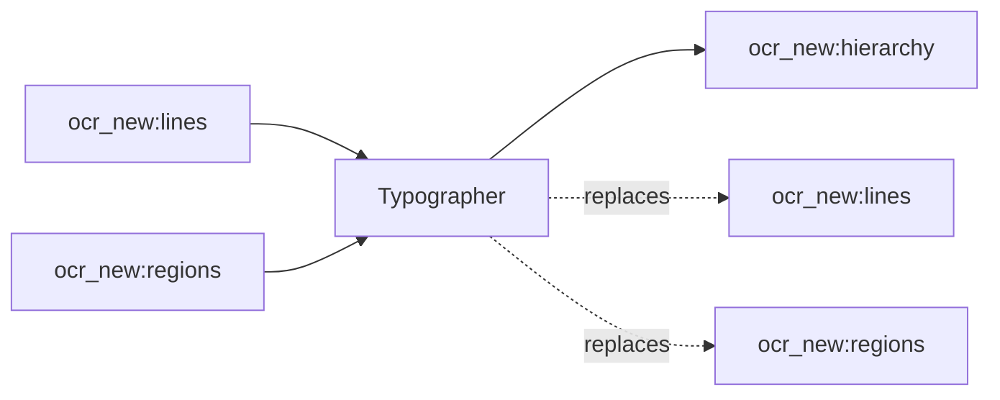

<!-- Generated by `linecaster docs`: edit the code, the docstrings or the catalog, not this file. -->
# Typographer

*Block · composition · `linecaster.blocks.composition`*

Determines the typographic hierarchy of every page by a typography engine.

|  |  |
|---|---|
| Unit | page |
| Role | transform |
| Reads | `ocr_new:lines`, `ocr_new:regions` |
| Adds | `ocr_new:hierarchy` |
| Replaces | `ocr_new:lines`, `ocr_new:regions` |
| Backends | in-process only (a built-in engine) |
| Catalog step | `typography` |
| Presets | [`ratios@1`](../../catalog/presets/typography/ratios.md) |
| Comes after | [`LayoutDetector`](../layout/LayoutDetector.md), [`LineDetector`](../lines/LineDetector.md), [`RegionRecognizer`](../recognition/RegionRecognizer.md), [`ModularTranscriber`](../composites/ModularTranscriber.md) |
| Comes before | - |
| Used in | [`transcribe_modular.v1`](../../catalog/pipelines/transcribe_modular.v1.md) |
| Source | [typographer.py](https://github.com/storytracer/linecaster/blob/main/src/linecaster/blocks/composition/typographer.py) |

The contract is that of `Typographer(preset='ratios@1')`; the comes-after and comes-before rows are derived from every block's contract.

## Options

| Option | Type | Default | Description |
|---|---|---|---|
| `preset` |  | required | the engine: a catalog preset of the block's step (`id@edition`; `id` alone is its latest edition) or an engine spec, `InProcess("module:Class", **options)`; a preset of another step, an engine of another step or options its engine does not have are refused (`PipelineConfigError`). |
| `transcription` | `str` | `'ocr_new'` | the transcription it works on. |
| `options` | `dict[str, Any] \| None` | `None` | engine options over the preset's (recorded as the backend's `overrides`); `None`: the preset's as they are. |

## Behavior

Heading levels from type size, headline splits, drop capitals, uncertain page numbers removed (see
`linecaster.text.typography`). Reads `regions` and `lines`; adds `hierarchy`; replaces `regions` and
`lines` (heading levels, headline splits, page numbers removed). Stats: `leveled`, `demoted`, `split`,
`drop_capitals`, `numbers_dropped`. Its constructor is `RuleBlock`'s (`preset`, `transcription`,
`options`).

## Contract



## Example

```python
Typographer("ratios@1")
```
