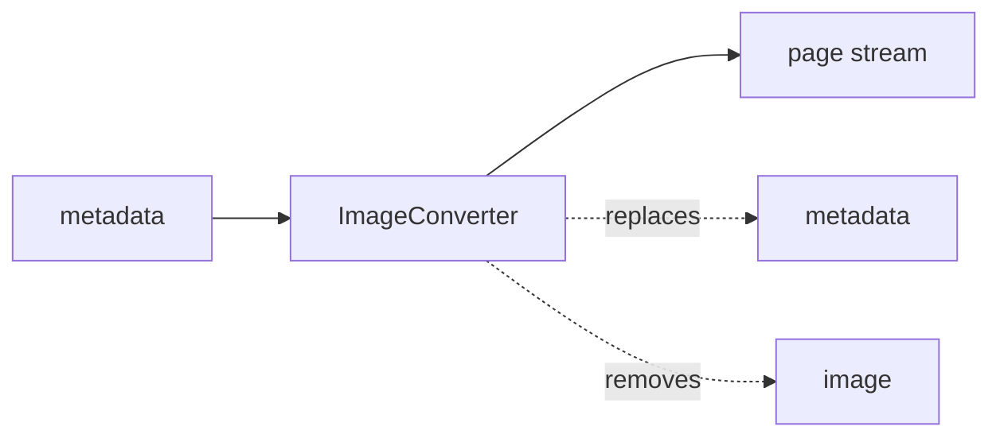

<!-- Generated by `linecaster docs`: edit the code, the docstrings or the catalog, not this file. -->
# ImageConverter

*Block · conversion · `linecaster.blocks.conversion`*

Converts each page's delivered image into the working image with an image engine and writes it.

|  |  |
|---|---|
| Unit | page |
| Role | transform |
| Reads | `metadata` |
| Adds | - |
| Replaces | `metadata` |
| Removes | `image` |
| Backends | in-process only (a built-in engine) |
| Catalog step | `image` |
| Presets | [`working-image@1`](../../catalog/presets/image/working-image.md) |
| Comes after | any reader |
| Comes before | - |
| Used in | - |
| Source | [images.py](https://github.com/storytracer/linecaster/blob/main/src/linecaster/blocks/conversion/images.py) |

The contract is that of `ImageConverter(output_folder='out/images', preset='working-image@1')`; the comes-after and comes-before rows are derived from every block's contract.

## Options

| Option | Type | Default | Description |
|---|---|---|---|
| `output_folder` | `DataFolderLike` | required | the folder (local path, fsspec URI or `DataFolder`) the working images go to. |
| `preset` |  | required | the image preset (`id@edition`, e.g. `working-image@1`) or an engine spec (`InProcess("module:Class", **options)`). |
| `keep_bytes` | `bool` | `False` | the WebP replaces `doc.media`, so later blocks need not read it again (it then also replaces `image`); without it the page leaves with no image bytes. |
| `options` | `dict \| None` | `None` | engine options over the preset's (recorded as the backend's `overrides`). |

## Behavior

With `working-image@1` (engine `image.webp-lossless.v1`, `linecaster.images.convert.to_working_webp`)
the working image is 8-bit sRGB, lossless WebP at full resolution, method 0, exact. It is written to
`<output_folder>/<item_id>/<page_id>.webp` (`_/<page_id>.webp` for a page without item), and
`page.image` becomes the working image's `PageImage` (size, hashes, decoder): it reads and replaces
`metadata`, and with `keep_bytes` replaces `image`; without it, it removes `image` (the page leaves with
no image bytes, so a later block that reads the image needs an `ImageFetcher` first). The delivered file is only read (from `doc.media` when the reader brought it, else from its
URI); its location, format, sha256, size and mode stay under `page.image.extra["original"]`, the step
(engine, preset edition and hash, settings) under `page.image.extra["step"]` (a `StepInfo`: the image
belongs to no transcription). A page without an image address, over the size limit (`check_size`) or that
cannot be decoded keeps its image and carries the reason as an error (field `image`), so later model blocks
pass it by and the `RejectWriter` writes it. The engine runs in the pipeline's process only.

## Contract

