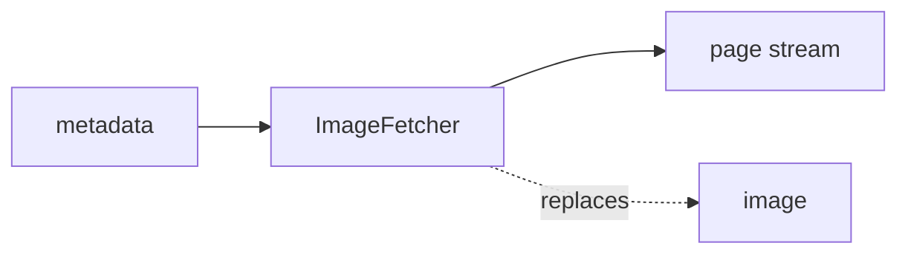

<!-- Generated by `linecaster docs`: edit the code, the docstrings or the catalog, not this file. -->
# ImageFetcher

*Block · conversion · `linecaster.blocks.conversion`*

Loads each page's image again from its address, for the blocks that need pixels.

|  |  |
|---|---|
| Unit | page |
| Role | transform |
| Reads | `metadata` |
| Adds | - |
| Replaces | `image` |
| Comes after | any reader |
| Comes before | - |
| Used in | - |
| Source | [images.py](https://github.com/storytracer/linecaster/blob/main/src/linecaster/blocks/conversion/images.py) |

The comes-after and comes-before rows are derived from every block's contract.

## Options

| Option | Type | Default | Description |
|---|---|---|---|
| `*args` |  |  |  |
| `**kwargs` |  |  |  |

## Behavior

It reads `page.image.uri` (any fsspec path; a `#` fragment is dropped) into `doc.media`: it replaces
`image`. `PageRecordReader(fetch_images=False)` followed by an `ImageFetcher` after filtering avoids
fetching the images of pages that are dropped anyway. A page without an image address is counted
(`no_image`) and passed on as it is.

## Contract

