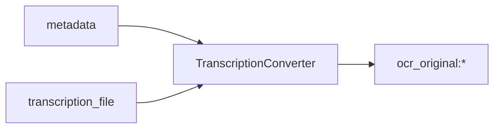

<!-- Generated by `linecaster docs`: edit the code, the docstrings or the catalog, not this file. -->
# TranscriptionConverter

*Block · conversion · `linecaster.blocks.conversion`*

Reads the transcription file that comes with each page (ALTO, PAGE-XML, hOCR or plain text) into a named transcription.

|  |  |
|---|---|
| Unit | page |
| Role | transform |
| Reads | `metadata`, `transcription_file` |
| Adds | `ocr_original:*` |
| Replaces | - |
| Comes after | any reader |
| Comes before | - |
| Used in | [`harvest.v1`](../../catalog/pipelines/harvest.v1.md) |
| Source | [transcriptions.py](https://github.com/storytracer/linecaster/blob/main/src/linecaster/blocks/conversion/transcriptions.py) |

The comes-after and comes-before rows are derived from every block's contract.

## Options

| Option | Type | Default | Description |
|---|---|---|---|
| `format` | `str` | `'auto'` | `auto` (the media's `metadata["format"]`, else told from the content), `alto`, `page`, `hocr` or `text`. |
| `source` | `str` | `'media'` | `media` (the page's first document media with bytes) or `uri` (the file named by `uri_key`). |
| `transcription` | `str` | `'ocr_original'` | the name of the transcription it fills. |
| `uri_key` | `str \| None` | `None` | the key of `page.metadata` that holds the file's URI (any fsspec path or URL), a dotted path into nested metadata; needed with `source="uri"` and only then. |

## Behavior

The file is a document media of the page (`source="media"`: what `ManifestReader(existing_ocr=True)` brings,
the part `transcription_file`) or is named by a URI in the page's metadata (`source="uri"`). It is read with
linecaster's `from_alto` / `from_page` / `from_hocr` (or as lines of plain text) at the page image's size:
ALTO is scaled to the image by its own page size, PAGE-XML and hOCR by the image size they state, when it
differs. It adds whatever the file holds (`<transcription>:*`) and replaces whatever the page had under that
name; the transcription's `source` records the format, the file's URI and the page image (hash and size). A
file that cannot be read is the page's error; a page without one passes unchanged (`pages_without_file`). The
builder puts one after a reader that brings transcription files when the pipeline has none.

## Contract

