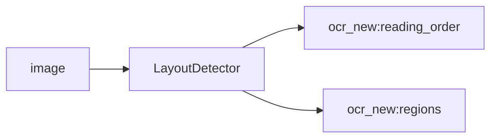

<!-- Generated by `linecaster docs`: edit the code, the docstrings or the catalog, not this file. -->
# LayoutDetector

*Block · layout · `linecaster.blocks.layout`*

Detects the layout regions of every page, with their labels and reading order, by a layout engine.

|  |  |
|---|---|
| Unit | page |
| Role | model |
| Reads | `image` |
| Adds | `ocr_new:reading_order`, `ocr_new:regions` |
| Replaces | - |
| Backends | in-process (`InProcess`), served (`Served`), a preset ref (`id@edition`) builds one |
| Catalog step | `layout` |
| Presets | [`pp-doclayout-plus-l@2`](../../catalog/presets/layout/pp-doclayout-plus-l.md), [`pp-doclayoutv3@1`](../../catalog/presets/layout/pp-doclayoutv3.md), [`single-region@1`](../../catalog/presets/layout/single-region.md) |
| Comes after | any reader |
| Comes before | [`LineAssigner`](../lines/LineAssigner.md), [`FormulaRecognizer`](../recognition/FormulaRecognizer.md), [`RegionRecognizer`](../recognition/RegionRecognizer.md), [`TableRecognizer`](../recognition/TableRecognizer.md), [`Composer`](../composition/Composer.md), [`Recomposer`](../composition/Recomposer.md), [`Typographer`](../composition/Typographer.md) |
| Used in | [`transcribe_modular.v1`](../../catalog/pipelines/transcribe_modular.v1.md), [`transcribe_vlm.v1`](../../catalog/pipelines/transcribe_vlm.v1.md) |
| Source | [detector.py](https://github.com/storytracer/linecaster/blob/main/src/linecaster/blocks/layout/detector.py) |

The contract is that of `LayoutDetector(backend='pp-doclayoutv3@1')`; the comes-after and comes-before rows are derived from every block's contract.

## Options

| Option | Type | Default | Description |
|---|---|---|---|
| `backend` | `InProcess \| Served \| str` | required | where the engine runs: `InProcess`, `Served`, or a catalog preset's ref (`id` or `id@edition`) for its engine in the pipeline's process; a preset of another step is refused (`PipelineConfigError`). |
| `transcription` | `str` | `'ocr_new'` | the transcription the step reads and adds to. |
| `params` | `dict \| None` | `None` | keyword arguments for every call of the engine (in-process) or sent with every request (served); `None`: none. |
| `primary` | `str \| None` | `None` | the transcription whose text becomes the datatrove document's `text`; `None`: `transcription`. |
| `skip_on_error` | `bool` | `True` | pass pages that carry errors through unprocessed. |
| `name` | `str \| None` | `None` | the block's name in stats and logs; `None`: `"<step> (<backend>)"`. |

## Behavior

Reads the page image; adds `regions` and `reading_order` (or what its preset produces) to the
transcription. A layout preset's `labels` map the model's native labels to DoclingDocument labels.
`LayoutDetector("single-region@1")` reads the whole page as one `text` region (the built-in engine
`layout.single-region.v1`, no model, in the pipeline's process only).

## Contract



## Example

```python
LayoutDetector("pp-doclayoutv3@1")
LayoutDetector("single-region@1")
```
