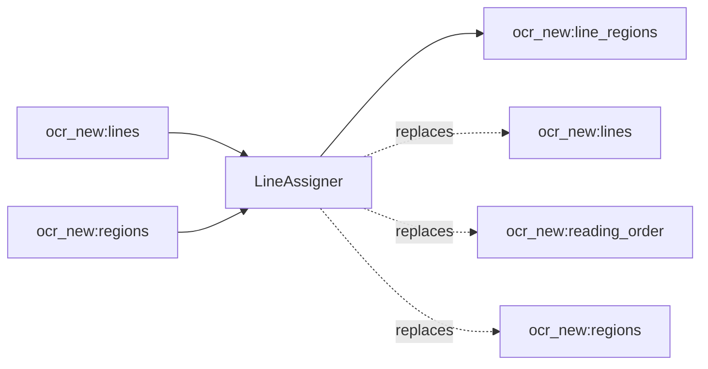

<!-- Generated by `linecaster docs`: edit the code, the docstrings or the catalog, not this file. -->
# LineAssigner

*Block · lines · `linecaster.blocks.lines`*

Assigns the lines detected on the whole page to the layout regions and orders them row by row.

|  |  |
|---|---|
| Unit | page |
| Role | transform |
| Reads | `ocr_new:lines`, `ocr_new:regions` |
| Adds | `ocr_new:line_regions` |
| Replaces | `ocr_new:lines`, `ocr_new:reading_order`, `ocr_new:regions` |
| Comes after | [`LayoutDetector`](../layout/LayoutDetector.md), [`LineDetector`](LineDetector.md), [`RegionRecognizer`](../recognition/RegionRecognizer.md), [`ModularTranscriber`](../composites/ModularTranscriber.md) |
| Comes before | - |
| Used in | - |
| Source | [assigner.py](https://github.com/storytracer/linecaster/blob/main/src/linecaster/blocks/lines/assigner.py) |

The comes-after and comes-before rows are derived from every block's contract.

## Options

| Option | Type | Default | Description |
|---|---|---|---|
| `transcription` | `str` | `'ocr_new'` | the transcription whose lines and regions it works on. |
| `skip_labels` |  | `frozenset({'chart', 'picture'})` | region labels that take no lines (default pictures and charts). |
| `formulas_separately` | `bool` | `True` | formula regions take no lines either and the lines inside them are dropped, for a formula step that reads them as LaTeX; `False`: formula regions get lines like text regions. |

## Behavior

Each line goes to the region it overlaps most; lines outside every region (a page number the layout model
missed, marginalia) become their own `text` regions (`orphan_<n>`), one per visual row, slotted into the
reading order; duplicates are dropped. Afterwards the list order of `lines` is the order a recognizer
follows (regions in the layout step's order, orphan rows last, rows within each region), `reading_order` is
the reading rank (regions by reading order, then rows), and line ids are `<region id>_l<n>`.

Reads `lines` and `regions`; adds `line_regions`; replaces `regions` (the orphan regions),
`reading_order` and `lines` (ids and order). Lines inside skipped regions are dropped (stat
`lines_in_skipped_regions`); stat `orphan_rows` counts the rows that became regions.

## Contract

