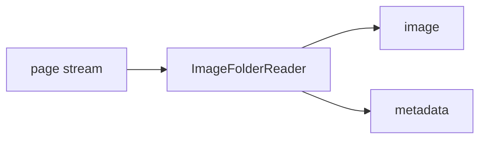

<!-- Generated by `linecaster docs`: edit the code, the docstrings or the catalog, not this file. -->
# ImageFolderReader

*Block · readers · `linecaster.blocks.readers`*

Reads one page per image file of a folder or bucket.

|  |  |
|---|---|
| Unit | page |
| Role | reader |
| Reads | - |
| Adds | `image`, `metadata` |
| Replaces | - |
| Comes after | - |
| Comes before | [`LayoutDetector`](../layout/LayoutDetector.md), [`LineDetector`](../lines/LineDetector.md), [`FormulaRecognizer`](../recognition/FormulaRecognizer.md), [`LineRecognizer`](../recognition/LineRecognizer.md), [`PageRecognizer`](../recognition/PageRecognizer.md), [`RegionRecognizer`](../recognition/RegionRecognizer.md), [`TableRecognizer`](../recognition/TableRecognizer.md), [`ImageConverter`](../conversion/ImageConverter.md), [`ImageFetcher`](../conversion/ImageFetcher.md), [`TranscriptionConverter`](../conversion/TranscriptionConverter.md), [`ImageFilesWriter`](../writers/ImageFilesWriter.md), [`ModularTranscriber`](../composites/ModularTranscriber.md) |
| Used in | - |
| Source | [images.py](https://github.com/storytracer/linecaster/blob/main/src/linecaster/blocks/readers/images.py) |

The contract is that of `ImageFolderReader(data_folder='scans/')`; the comes-after and comes-before rows are derived from every block's contract.

## Options

| Option | Type | Default | Description |
|---|---|---|---|
| `data_folder` | `DataFolderLike` | required | the folder (local path, fsspec URI or `DataFolder`) the images are read from. |
| `paths_file` | `DataFileLike \| None` | `None` | a file listing the images to read, one path per line relative to `data_folder`; default: every file matching `glob_pattern`. |
| `glob_pattern` | `str` | `'**/*.{webp,jpg,jpeg,png,tif,tiff,jp2}'` | the image files to read; `{a,b}` alternatives are expanded. Default: WebP, JPEG, PNG, TIFF and JPEG 2000 files at any depth. |
| `recursive` | `bool` | `True` | datatrove's `BaseDiskReader` arguments. |
| `limit` | `int` | `-1` | datatrove's `BaseDiskReader` arguments. |
| `skip` | `int` | `0` | datatrove's `BaseDiskReader` arguments. |
| `item_from_parent` | `bool` | `False` | the parent folder's name is each page's `item_id`; excludes `item_id`. |
| `item_id` | `str \| None` | `None` | every page belongs to this one item; excludes `item_from_parent`. Default: pages without item. |
| `sequence` | `bool` | `False` | sets `Page.sequence` to the file's 1-based position among its item's files in sorted order; needs `glob_pattern` (every file of an item), not `paths_file`. |
| `file_progress` | `bool` | `False` | datatrove's `BaseDiskReader` arguments. |
| `doc_progress` | `bool` | `False` | datatrove's `BaseDiskReader` arguments. |
| `default_metadata` | `dict \| None` | `None` | goes into every page's metadata. |
| `shuffle_files` | `bool` | `False` | datatrove's `BaseDiskReader` arguments. |
| `max_pages` | `int \| None` | `None` | only the first `max_pages` files (sorted, or as `paths_file` lists them), for the whole run, divided over the tasks as all of them would be; default: every file. |

## Behavior

The image files under `data_folder` matching `glob_pattern`, or the files listed in `paths_file` (one per
line, relative to `data_folder`), are distributed over tasks in turn (`[rank::world_size]`, as
`DataFolder.get_shard`). Each page adds `image` (the file's bytes) and `metadata` (the page record:
`page_id` is the file name without extension, the image's URI). `limit` and `skip` count pages per task,
as in datatrove. An item's pages can land in different tasks: item-level steps run in a later stage over item
shards (`linecaster.blocks.writers.shards`). No matching file fails the task with a `PipelineConfigError`.

## Contract

