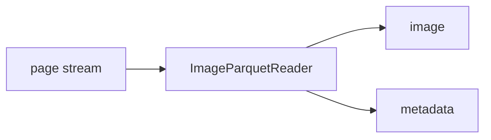

<!-- Generated by `linecaster docs`: edit the code, the docstrings or the catalog, not this file. -->
# ImageParquetReader

*Block · readers · `linecaster.blocks.readers`*

Reads one page per row of Parquet files with an image column.

|  |  |
|---|---|
| Unit | page |
| Role | reader |
| Reads | - |
| Adds | `image`, `metadata` |
| Replaces | - |
| Comes after | - |
| Comes before | [`LayoutDetector`](../layout/LayoutDetector.md), [`LineDetector`](../lines/LineDetector.md), [`FormulaRecognizer`](../recognition/FormulaRecognizer.md), [`LineRecognizer`](../recognition/LineRecognizer.md), [`PageRecognizer`](../recognition/PageRecognizer.md), [`RegionRecognizer`](../recognition/RegionRecognizer.md), [`TableRecognizer`](../recognition/TableRecognizer.md), [`ImageConverter`](../conversion/ImageConverter.md), [`ImageFetcher`](../conversion/ImageFetcher.md), [`TranscriptionConverter`](../conversion/TranscriptionConverter.md), [`ImageFilesWriter`](../writers/ImageFilesWriter.md), [`ModularTranscriber`](../composites/ModularTranscriber.md) |
| Used in | - |
| Source | [images.py](https://github.com/storytracer/linecaster/blob/main/src/linecaster/blocks/readers/images.py) |

The contract is that of `ImageParquetReader(data_folder='pages/')`; the comes-after and comes-before rows are derived from every block's contract.

## Options

| Option | Type | Default | Description |
|---|---|---|---|
| `data_folder` | `DataFolderLike` | required | the folder (local path, fsspec URI or `DataFolder`) of the Parquet files. |
| `paths_file` | `DataFileLike \| None` | `None` | datatrove's `ParquetReader` arguments. |
| `glob_pattern` | `str \| None` | `'**/*.parquet'` | datatrove's `ParquetReader` arguments. |
| `recursive` | `bool` | `True` | datatrove's `ParquetReader` arguments. |
| `limit` | `int` | `-1` | pages per task, as datatrove's count documents; they apply before anything is read or fetched. |
| `skip` | `int` | `0` | pages per task, as datatrove's count documents; they apply before anything is read or fetched. |
| `batch_size` | `int` | `64` | the rows read at once from a file. |
| `id_key` | `str` | `'id'` | the column with the page id. A table without it names its pages `<item>_<0001>` from `item_key` and `sequence_key`, which it then needs. |
| `image_key` | `str` | `'image'` | the column with the image. |
| `item_key` | `str \| None` | `None` | the column with the page's `item_id`; default: pages without item. |
| `sequence_key` | `str \| None` | `None` | the column with the page's position in its item (`Page.sequence`). |
| `image_folder` | `DataFolderLike \| None` | `None` | the folder relative image paths are read from; default `data_folder`. |
| `read_metadata` | `bool` | `False` | the other columns go into the page's metadata; without it only the named columns are read. |
| `file_progress` | `bool` | `False` | datatrove's `ParquetReader` arguments. |
| `doc_progress` | `bool` | `False` | datatrove's `ParquetReader` arguments. |
| `default_metadata` | `dict \| None` | `None` | goes into every page's metadata. |
| `shuffle_files` | `bool` | `False` | read the files of a task's shard in random order. |
| `http` | `dict \| None` | `None` | pybookget `Config` fields (rate limits, retries) for `http(s)://` image paths. Their images are requested ahead of the page being given on, as many as keep the rate limits busy (`linecaster.net.http.prefetched`); pages keep the rows' order. |
| `max_pages` | `int \| None` | `None` | only the first `max_pages` rows of the input, for the whole run: the tables are read as if they ended there, divided over the tasks (and `auto_tasks` counted) the same way; default: every row. |

## Behavior

The rows of all files, in order, are divided over the tasks in equal shards, read by row group
(`linecaster.blocks.readers.tables`), so any table works with any number of tasks; an item's pages can land in
two tasks where a shard ends. `auto_tasks` is the task count for shards of about `PAGES_PER_TASK` pages, which
`linecaster.runtime.run` uses for a pipeline without engines. Each row adds `image` and `metadata` (the page
record). The image column holds the image
as Hugging Face's `Image` feature stores it (`{"bytes", "path"}`: the bytes when present, else the path), as
plain bytes, or as a path: absolute (any fsspec URI, `http(s)://` through pybookget) or relative to
`image_folder`. A row with neither bytes nor a path fails the task (a `PageError`: the table is wrong).

An image that cannot be read (an http(s) error after pybookget's retries, a missing file, bytes that are not an
image) makes a page without image whose `doc.metadata["errors"]` says why (`field` `image`, `raw_value`
the image's URI), so the task goes on: later model blocks pass the page by, `ImageFilesWriter` writes no file
for it, and the page records and rejects keep it. More such pages than `max_page_errors` (a share of the task's
pages, judged from page 100 on, `ErrorBudget`) fail the task, so a server that is down does not mark every
page failed.

## Contract

