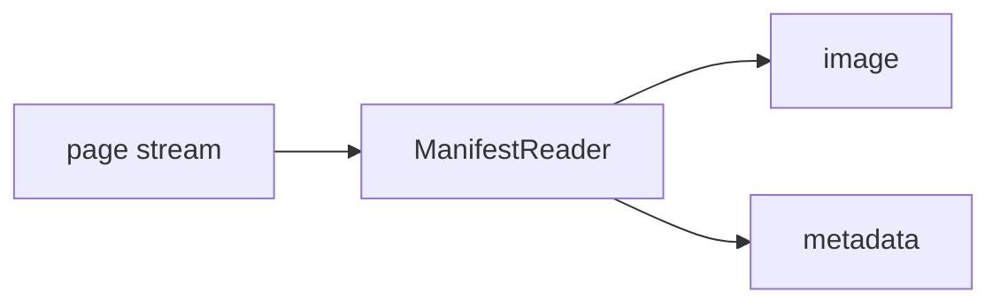

<!-- Generated by `linecaster docs`: edit the code, the docstrings or the catalog, not this file. -->
# ManifestReader

*Block · readers · `linecaster.blocks.readers`*

Reads one page per image of each item's manifest: IIIF Presentation 2 or 3, or METS with MODS (also inside an OAI-PMH response).

|  |  |
|---|---|
| Unit | page |
| Role | reader |
| Reads | - |
| Adds | `image`, `metadata` |
| Replaces | - |
| Comes after | - |
| Comes before | [`LayoutDetector`](../layout/LayoutDetector.md), [`LineDetector`](../lines/LineDetector.md), [`FormulaRecognizer`](../recognition/FormulaRecognizer.md), [`LineRecognizer`](../recognition/LineRecognizer.md), [`PageRecognizer`](../recognition/PageRecognizer.md), [`RegionRecognizer`](../recognition/RegionRecognizer.md), [`TableRecognizer`](../recognition/TableRecognizer.md), [`ImageConverter`](../conversion/ImageConverter.md), [`ImageFetcher`](../conversion/ImageFetcher.md), [`TranscriptionConverter`](../conversion/TranscriptionConverter.md), [`ImageFilesWriter`](../writers/ImageFilesWriter.md), [`ModularTranscriber`](../composites/ModularTranscriber.md) |
| Used in | - |
| Source | [manifests.py](https://github.com/storytracer/linecaster/blob/main/src/linecaster/blocks/readers/manifests.py) |

The comes-after and comes-before rows are derived from every block's contract.

## Options

| Option | Type | Default | Description |
|---|---|---|---|
| `data_folder` | `DataFolderLike` | `'.'` | the folder (local path, fsspec URI or `DataFolder`) of the manifests or item tables, and the base of relative links; default the current folder. |
| `paths_file` | `DataFileLike \| None` | `None` | datatrove's `BaseDiskReader` arguments. |
| `glob_pattern` | `str \| None` | `None` | the entries to read; default `**/*.{json,xml}` (manifests), `**/*.parquet` with `manifest_key`. |
| `recursive` | `bool` | `True` | datatrove's `BaseDiskReader` arguments. |
| `limit` | `int` | `-1` | pages per task, as datatrove's count documents; they apply before downloading. |
| `skip` | `int` | `0` | pages per task, as datatrove's count documents; they apply before downloading. |
| `manifest_key` | `str \| None` | `None` | the column of an item table that holds each item's manifest link; default: the entries are manifests. |
| `item_key` | `str \| None` | `None` | the column of an item table that holds each item's id; needs `manifest_key`. Default: the id from the manifest entry. |
| `read_metadata` | `bool` | `True` | an item table's other columns go into the metadata of each of the item's pages. |
| `manifest_format` | `str \| None` | `None` | `iiif` or `mets` forces the format; default: pybookget tells them apart by content. |
| `item_id_pattern` | `str \| None` | `None` | a regular expression whose first group, found in the manifest entry, is the item id (instead of the last path segment); an entry it does not match is a `PipelineConfigError`. |
| `existing_ocr` | `bool` | `False` | also fetch each page's own OCR file (`transcription_file`). |
| `manifest_folder` | `DataFolderLike \| None` | `None` | where every manifest read is saved as fetched, `<item_id>.json` / `.xml`; default: not saved. |
| `http` | `dict \| None` | `None` | pybookget `Config` fields over `linecaster.net.http.HTTP_DEFAULTS` (`rate_limits` of this task, `timeout`, `proxy`, `iiif_format`, `iiif_quality`, `mets_image_groups`, ...). |
| `file_progress` | `bool` | `False` | datatrove's `BaseDiskReader` arguments. |
| `doc_progress` | `bool` | `False` | datatrove's `BaseDiskReader` arguments. |
| `default_metadata` | `dict \| None` | `None` | goes into every page's metadata. |
| `shuffle_files` | `bool` | `False` | datatrove's `BaseDiskReader` arguments. |

## Behavior

Entries:

* without `manifest_key`: manifests: the files under `data_folder` matching `glob_pattern`, or the
  lines of `paths_file` (a manifest URL, or a path relative to `data_folder`), distributed over tasks in
  turn (`[rank::world_size]`) the way datatrove distributes files;
* with `manifest_key`: Parquet item tables (the files matching `glob_pattern`, or a `paths_file` listing
  them), one item per row: its manifest link in `manifest_key` (a URL, an absolute fsspec path, or a path
  relative to `data_folder`), its id in `item_key` (optional), and, with `read_metadata`, every other
  column in the metadata of each of its pages. The rows of all tables, not the files, are divided over the
  tasks in equal shards (`linecaster.blocks.readers.tables`), so one table works with any number of tasks.

`auto_tasks` is the task count for about `ITEMS_PER_TASK` items per task, which `linecaster.runtime.run`
uses for a pipeline without engines.

A manifest is one entry, so an item's pages stay in one task (`whole_items`). An entry that is a IIIF
Collection stands for its manifests, each an item named by its own link (a table's `item_key` does not apply
to them); a collection listed in it, or a paged one, raises `NotImplementedError` (one level).

Each page adds `image` and `metadata`; with `existing_ocr` also `transcription_file`. Pages:
`item_id` from `item_key`, else from the manifest entry (`manifest_item_id`: the last path segment that is
not a generic manifest name); `sequence` the page's 1-based position among the manifest's pages with an image;
`page_id` `<item_id>_<sequence:04d>`; `image.uri` the URL the image came from. `metadata["manifest"]`
keeps the format, the manifest's URL, id, label, rights, required statement, identifiers and descriptive
metadata, the page's own id and label, and the image request. Images are requested at full size (IIIF through
the image service, `iiif_format`/`iiif_quality` in `http`; METS from the first image file group in
`mets_image_groups`), with the fallback URL on 404.

With `existing_ocr`, a page's own OCR (ALTO or hOCR the manifest links: METS `FULLTEXT`, IIIF `seeAlso`
/ `rendering`) is fetched too, as a second media of the document (type document, `metadata["format"]`
`alto` or `hocr`): a `TranscriptionConverter` after the reader reads it into the transcription
`ocr_original` (the builder puts one there when the pipeline has none), and
`ImageFilesWriter(ocr_folder=...)` writes the bytes.

A manifest that cannot be read or parsed, an image or OCR file that fails after pybookget's retries, or a
response that is not an image is logged and counted (`manifests_failed`, `pages_failed`,
`pages_not_images`, `ocr_failed`), and the task goes on. Needs the extra `[pybookget]`.

Pages are requested ahead, across manifests, as many as keep the rate limits busy
(`linecaster.net.http.prefetched`), through one `HTTPFetcher.shared` per process and configuration, so the
rate limits hold across the tasks a worker runs one after the other.

## Contract

