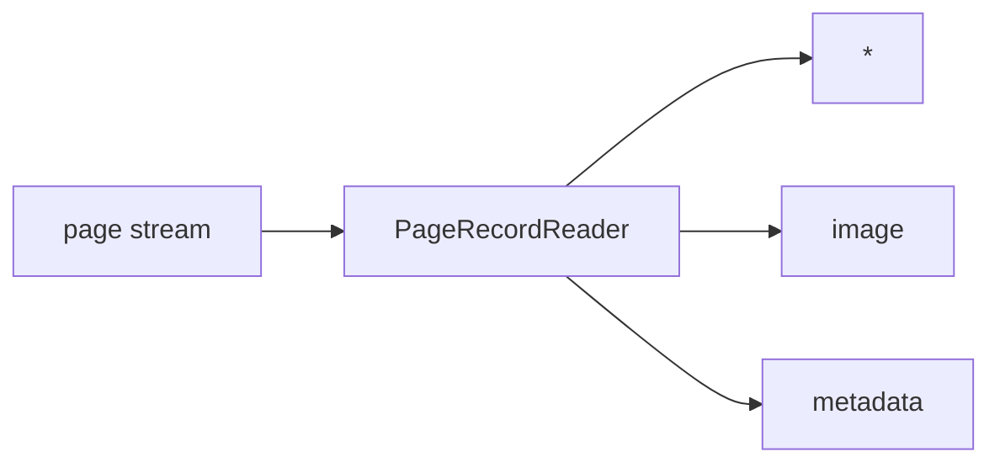

<!-- Generated by `linecaster docs`: edit the code, the docstrings or the catalog, not this file. -->
# PageRecordReader

*Block · readers · `linecaster.blocks.readers`*

Reads the page records an earlier run wrote (JSON Lines or Parquet), so a pipeline can add one more part.

|  |  |
|---|---|
| Unit | page |
| Role | reader |
| Reads | - |
| Adds | `*`, `image`, `metadata` |
| Replaces | - |
| Comes after | - |
| Comes before | [`LayoutDetector`](../layout/LayoutDetector.md), [`LineDetector`](../lines/LineDetector.md), [`FormulaRecognizer`](../recognition/FormulaRecognizer.md), [`LineRecognizer`](../recognition/LineRecognizer.md), [`PageRecognizer`](../recognition/PageRecognizer.md), [`RegionRecognizer`](../recognition/RegionRecognizer.md), [`TableRecognizer`](../recognition/TableRecognizer.md), [`ImageConverter`](../conversion/ImageConverter.md), [`ImageFetcher`](../conversion/ImageFetcher.md), [`TranscriptionConverter`](../conversion/TranscriptionConverter.md), [`ImageFilesWriter`](../writers/ImageFilesWriter.md), [`ResourceRecordWriter`](../writers/ResourceRecordWriter.md), [`ModularTranscriber`](../composites/ModularTranscriber.md) |
| Used in | [`bind.v1`](../../catalog/pipelines/bind.v1.md) |
| Source | [records.py](https://github.com/storytracer/linecaster/blob/main/src/linecaster/blocks/readers/records.py) |

The contract is that of `PageRecordReader(data_folder='out/pages')`; the comes-after and comes-before rows are derived from every block's contract.

## Options

| Option | Type | Default | Description |
|---|---|---|---|
| `data_folder` | `DataFolderLike` | required | the folder (local path, fsspec URI or `DataFolder`) of the page records. |
| `glob_pattern` | `str` | `'**/*.jsonl*'` | the record files to read; default JSON Lines (`**/*.jsonl*`), `**/*.parquet` for Parquet. |
| `fetch_images` | `bool` | `True` | read each page's image again (the part `image`); without it the pages carry no image. |
| `uri_map` | `dict[str, str] \| None` | `None` | image URI prefixes rewritten before reading (e.g. a Hub path to a local copy of the same files). |
| `item_shards` | `bool` | `False` | the records are item shards (`<shard>/<rank>...`), each read whole by one task. |
| `http` | `dict \| None` | `None` | pybookget `Config` fields for `http(s)://` image URIs. |
| `provides` |  | `None` | the parts the records carry (`"ocr_new:lines"`, `"ocr_original:*"`, or `Part`s), for the builder's checks; default: anything (`*`; reads after this reader are not checked). The builder sets it when it starts a stage from the page records of an earlier one. |

## Behavior

Each pipeline of a workflow reads the previous one's `pages/` folder (linecaster's page writers) and adds its
part. The records bring `metadata` and, with `fetch_images`, `image`: page records never carry the image
bytes, so they are read again from `page.image.uri` through datatrove `DataFolder`s (`http(s)://`
through pybookget); a URI with a fragment names a part of its file (`file.pdf#page=<n>`: that page rendered,
`file.parquet#<page_id>`: that row's image, `linecaster.blocks.readers.fragments`), and one that cannot be
resolved is the page's error (field `image`, stat `image_errors`), never the whole file. A page's errors
come back as `doc.metadata["errors"]`, so later model blocks pass it by.

Rows of an earlier format are read as today's (`upgrade`, by the row's `schema`): rows without `schema`
name linecaster's transcription `ocr` (read as `ocr_new`), `linecaster.page/1` rows a transcription's
steps `model` (read as `steps`); a folder `.../pages` that holds no records but has a sibling `rows`
(the folder's earlier name) is read from there.

Files are distributed over tasks in turn. With `item_shards` the page records were written into item shards
(`PageJsonlWriter(item_shards=N)`): the shard folders are distributed instead, each read whole, so a task
sees every page of its items (`whole_items`). No shard folder is a `PipelineConfigError`.

## Contract

