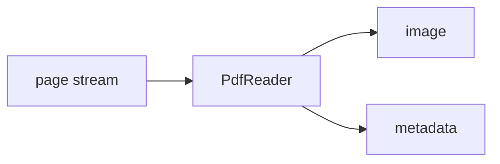

<!-- Generated by `linecaster docs`: edit the code, the docstrings or the catalog, not this file. -->
# PdfReader

*Block · readers · `linecaster.blocks.readers`*

Reads one item per PDF file, one page per PDF page in order, each rendered to a lossless WebP image.

|  |  |
|---|---|
| Unit | page |
| Role | reader |
| Reads | - |
| Adds | `image`, `metadata` |
| Replaces | - |
| Comes after | - |
| Comes before | [`LayoutDetector`](../layout/LayoutDetector.md), [`LineDetector`](../lines/LineDetector.md), [`FormulaRecognizer`](../recognition/FormulaRecognizer.md), [`LineRecognizer`](../recognition/LineRecognizer.md), [`PageRecognizer`](../recognition/PageRecognizer.md), [`RegionRecognizer`](../recognition/RegionRecognizer.md), [`TableRecognizer`](../recognition/TableRecognizer.md), [`ImageConverter`](../conversion/ImageConverter.md), [`ImageFetcher`](../conversion/ImageFetcher.md), [`TranscriptionConverter`](../conversion/TranscriptionConverter.md), [`ImageFilesWriter`](../writers/ImageFilesWriter.md), [`ModularTranscriber`](../composites/ModularTranscriber.md) |
| Used in | - |
| Source | [pdf.py](https://github.com/storytracer/linecaster/blob/main/src/linecaster/blocks/readers/pdf.py) |

The contract is that of `PdfReader(data_folder='pdfs/')`; the comes-after and comes-before rows are derived from every block's contract.

## Options

| Option | Type | Default | Description |
|---|---|---|---|
| `data_folder` | `DataFolderLike` | required | the folder (local path, fsspec URI or `DataFolder`) of the PDF files. |
| `paths_file` | `DataFileLike \| None` | `None` | datatrove's `BaseDiskReader` arguments. |
| `glob_pattern` | `str` | `'**/*.pdf'` | the files to read; default every `.pdf` at any depth. |
| `dpi` | `float` | `300` | the resolution pages are rendered at; positive. |
| `text_layer` | `bool` | `False` | read the PDF's own text as `ocr_original`; not implemented (`True` raises `NotImplementedError`). |
| `recursive` | `bool` | `True` | datatrove's `BaseDiskReader` arguments. |
| `limit` | `int` | `-1` | datatrove's `BaseDiskReader` arguments. |
| `skip` | `int` | `0` | datatrove's `BaseDiskReader` arguments. |
| `file_progress` | `bool` | `False` | datatrove's `BaseDiskReader` arguments. |
| `doc_progress` | `bool` | `False` | datatrove's `BaseDiskReader` arguments. |
| `default_metadata` | `dict \| None` | `None` | goes into every page's metadata. |
| `shuffle_files` | `bool` | `False` | datatrove's `BaseDiskReader` arguments. |

## Behavior

`item_id` is the file name without `.pdf`; `sequence` counts from 1, `page_id` is
`<item_id>_<sequence:04d>`. Each page adds `image` (rendered at `dpi`) and `metadata`: `image.uri` is
the PDF's path with `#page=<n>`, `metadata["pdf"]` the page's number, its size in points and the resolution.
Files as datatrove reads them: under `data_folder` matching `glob_pattern`, or listed in `paths_file`,
distributed over tasks in turn, so an item stays in one task (`whole_items`); `limit` and `skip` count
pages. A page too large to render (over WebP's or Pillow's size limit at `dpi`) is logged and counted
(`pages_too_large`), and the item goes on. Needs the extra `[pypdfium2]`.

## Contract

