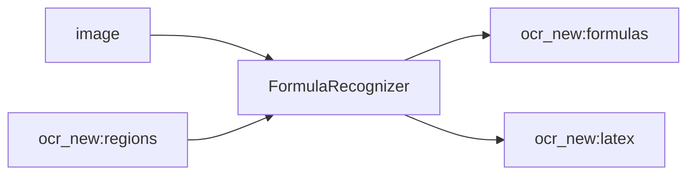

<!-- Generated by `linecaster docs`: edit the code, the docstrings or the catalog, not this file. -->
# FormulaRecognizer

*Block · recognition · `linecaster.blocks.recognition`*

Recognizes every formula region as LaTeX by a formula engine.

|  |  |
|---|---|
| Unit | page |
| Role | model |
| Reads | `image`, `ocr_new:regions` |
| Adds | `ocr_new:formulas`, `ocr_new:latex` |
| Replaces | - |
| Backends | in-process (`InProcess`), served (`Served`), a preset ref (`id@edition`) builds one |
| Catalog step | `formulas` |
| Presets | [`pp-formulanet-l@1`](../../catalog/presets/formulas/pp-formulanet-l.md), [`pp-formulanet-plus-l@1`](../../catalog/presets/formulas/pp-formulanet-plus-l.md) |
| Comes after | any reader, [`LayoutDetector`](../layout/LayoutDetector.md), [`ModularTranscriber`](../composites/ModularTranscriber.md) |
| Comes before | - |
| Used in | [`transcribe_modular.v1`](../../catalog/pipelines/transcribe_modular.v1.md) |
| Source | [recognizers.py](https://github.com/storytracer/linecaster/blob/main/src/linecaster/blocks/recognition/recognizers.py) |

The contract is that of `FormulaRecognizer(backend='pp-formulanet-plus-l@1')`; the comes-after and comes-before rows are derived from every block's contract.

## Options

| Option | Type | Default | Description |
|---|---|---|---|
| `backend` | `InProcess \| Served \| str` | required | where the engine runs: `InProcess`, `Served`, or a catalog preset's ref (`id` or `id@edition`) for its engine in the pipeline's process; a preset of another step is refused (`PipelineConfigError`). |
| `transcription` | `str` | `'ocr_new'` | the transcription the step reads and adds to. |
| `params` | `dict \| None` | `None` | keyword arguments for every call of the engine (in-process) or sent with every request (served); `None`: none. |
| `primary` | `str \| None` | `None` | the transcription whose text becomes the datatrove document's `text`; `None`: `transcription`. |
| `skip_on_error` | `bool` | `True` | pass pages that carry errors through unprocessed. |
| `name` | `str \| None` | `None` | the block's name in stats and logs; `None`: `"<step> (<backend>)"`. |

## Behavior

Reads the page image and the transcription's `regions`; adds `formulas` (or what its preset produces:
`latex`). A page without a `formula` region gets no image: the engine has nothing to read. A
`LineAssigner` (or `ModularTranscriber`) with `formulas_separately` leaves formula regions without lines
for it.

## Contract



## Example

```python
FormulaRecognizer("pp-formulanet-plus-l@1")
```
