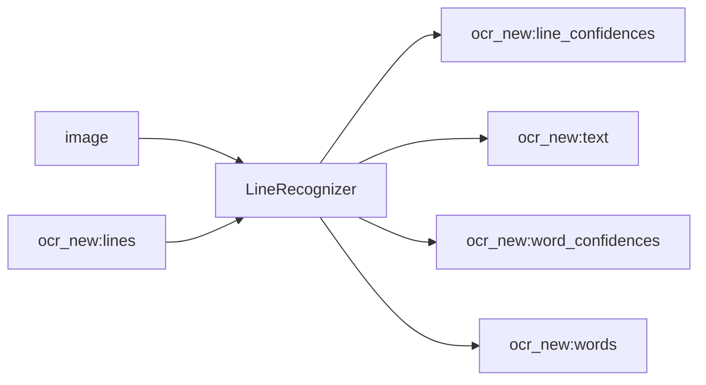

<!-- Generated by `linecaster docs`: edit the code, the docstrings or the catalog, not this file. -->
# LineRecognizer

*Block · recognition · `linecaster.blocks.recognition`*

Recognizes the text of every line by a line recognition engine.

|  |  |
|---|---|
| Unit | page |
| Role | model |
| Reads | `image`, `ocr_new:lines` |
| Adds | `ocr_new:line_confidences`, `ocr_new:text`, `ocr_new:word_confidences`, `ocr_new:words` |
| Replaces | - |
| Backends | in-process (`InProcess`), served (`Served`), a preset ref (`id@edition`) builds one |
| Catalog step | `recognition` |
| Presets | [`kraken-ppocrv6-medium@1`](../../catalog/presets/recognition/kraken-ppocrv6-medium.md), [`kraken-ppocrv6-small@1`](../../catalog/presets/recognition/kraken-ppocrv6-small.md), [`kraken-ppocrv6-tiny@1`](../../catalog/presets/recognition/kraken-ppocrv6-tiny.md), [`paddlex-ppocrv6-medium@1`](../../catalog/presets/recognition/paddlex-ppocrv6-medium.md), [`paddlex-ppocrv6-small@1`](../../catalog/presets/recognition/paddlex-ppocrv6-small.md), [`paddlex-ppocrv6-tiny@1`](../../catalog/presets/recognition/paddlex-ppocrv6-tiny.md), [`tesseract-best-eng@1`](../../catalog/presets/recognition/tesseract-best-eng.md), [`tesseract-best-latin@1`](../../catalog/presets/recognition/tesseract-best-latin.md), [`tesseract-fast-eng@1`](../../catalog/presets/recognition/tesseract-fast-eng.md), [`tesseract-fast-latin@1`](../../catalog/presets/recognition/tesseract-fast-latin.md) |
| Comes after | any reader, [`LineDetector`](../lines/LineDetector.md), [`RegionRecognizer`](RegionRecognizer.md), [`ModularTranscriber`](../composites/ModularTranscriber.md) |
| Comes before | [`CharacterNormalizer`](../text/CharacterNormalizer.md), [`UnicodeNormalizer`](../text/UnicodeNormalizer.md), [`PageFileWriter`](../writers/PageFileWriter.md) |
| Used in | [`transcribe_modular.v1`](../../catalog/pipelines/transcribe_modular.v1.md) |
| Source | [recognizers.py](https://github.com/storytracer/linecaster/blob/main/src/linecaster/blocks/recognition/recognizers.py) |

The contract is that of `LineRecognizer(backend='kraken-ppocrv6-medium@1')`; the comes-after and comes-before rows are derived from every block's contract.

## Options

| Option | Type | Default | Description |
|---|---|---|---|
| `backend` | `InProcess \| Served \| str` | required | where the engine runs: `InProcess`, `Served`, or a catalog preset's ref (`id` or `id@edition`) for its engine in the pipeline's process; a preset of another step is refused (`PipelineConfigError`). |
| `transcription` | `str` | `'ocr_new'` | the transcription the step reads and adds to. |
| `params` | `dict \| None` | `None` | keyword arguments for every call of the engine (in-process) or sent with every request (served); `None`: none. |
| `primary` | `str \| None` | `None` | the transcription whose text becomes the datatrove document's `text`; `None`: `transcription`. |
| `skip_on_error` | `bool` | `True` | pass pages that carry errors through unprocessed. |
| `name` | `str \| None` | `None` | the block's name in stats and logs; `None`: `"<step> (<backend>)"`. |

## Behavior

Reads the page image and the transcription's `lines`; adds `text` and what its preset produces (`words`,
word and line confidences, ...), the lines in the order the line step left them. One page per call or request;
an engine batches only the lines of one page.

## Contract



## Example

```python
from linecaster.backends import InProcess

LineRecognizer("kraken-ppocrv6-medium@1")
LineRecognizer(InProcess("linecaster_kraken:KrakenRecognitionEngine"))
```
