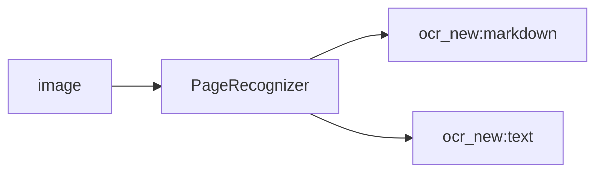

<!-- Generated by `linecaster docs`: edit the code, the docstrings or the catalog, not this file. -->
# PageRecognizer

*Block · recognition · `linecaster.blocks.recognition`*

Recognizes every page with a chat VLM, whose completion becomes the page's transcription.

|  |  |
|---|---|
| Unit | page |
| Role | model |
| Reads | `image` |
| Adds | `ocr_new:markdown`, `ocr_new:text` |
| Replaces | - |
| Backends | chat (`Chat`), a preset ref (`id@edition`) builds one |
| Catalog step | `recognition` |
| Presets | [`chandra-ocr-2@1`](../../catalog/presets/recognition/chandra-ocr-2.md), [`deepseek-ocr@1`](../../catalog/presets/recognition/deepseek-ocr.md), [`deepseek-ocr-2@1`](../../catalog/presets/recognition/deepseek-ocr-2.md), [`dots-mocr@1`](../../catalog/presets/recognition/dots-mocr.md), [`dots-ocr@1`](../../catalog/presets/recognition/dots-ocr.md), [`glm-ocr@1`](../../catalog/presets/recognition/glm-ocr.md), [`lightonocr-2-1b@1`](../../catalog/presets/recognition/lightonocr-2-1b.md), [`lightonocr-3-0.8b@1`](../../catalog/presets/recognition/lightonocr-3-0.8b.md), [`lightonocr-3-4b@1`](../../catalog/presets/recognition/lightonocr-3-4b.md), [`nemotron-3.5-parse@1`](../../catalog/presets/recognition/nemotron-3.5-parse.md), [`olmocr-2-7b-1025-fp8@1`](../../catalog/presets/recognition/olmocr-2-7b-1025-fp8.md), [`ovisocr2@1`](../../catalog/presets/recognition/ovisocr2.md), [`ovisocr3@1`](../../catalog/presets/recognition/ovisocr3.md), [`paddleocr-vl-1.6@1`](../../catalog/presets/recognition/paddleocr-vl-1.6.md), [`qianfan-ocr@1`](../../catalog/presets/recognition/qianfan-ocr.md), [`qwen3.5-9b@1`](../../catalog/presets/recognition/qwen3.5-9b.md), [`smoldocling-256m-preview@1`](../../catalog/presets/recognition/smoldocling-256m-preview.md), [`unlimited-ocr@1`](../../catalog/presets/recognition/unlimited-ocr.md), [`unlimited-ocr-2@1`](../../catalog/presets/recognition/unlimited-ocr-2.md) |
| Comes after | any reader |
| Comes before | [`CharacterNormalizer`](../text/CharacterNormalizer.md), [`UnicodeNormalizer`](../text/UnicodeNormalizer.md), [`PageFileWriter`](../writers/PageFileWriter.md) |
| Used in | [`transcribe_vlm.v1`](../../catalog/pipelines/transcribe_vlm.v1.md) |
| Source | [chat.py](https://github.com/storytracer/linecaster/blob/main/src/linecaster/blocks/recognition/chat.py) |

The contract is that of `PageRecognizer(backend='lightonocr-2-1b@1')`; the comes-after and comes-before rows are derived from every block's contract.

## Options

| Option | Type | Default | Description |
|---|---|---|---|
| `backend` | `Chat \| str` | required | a `Chat` backend, or a chat preset's ref (its page preset) for one on the task's `ChatModelServer`; any other backend is refused (`PipelineConfigError`). |
| `transcription` | `str` | `'ocr_new'` | the transcription the completion becomes. |
| `primary` | `str \| None` | `None` | the transcription whose text becomes the datatrove document's `text`; `None`: `transcription`. |
| `skip_on_error` | `bool` | `True` | pass pages that carry errors through unprocessed. |
| `prepare_workers` | `int` | `4` | threads that build requests ahead of admission (decode, resize and PNG-encode the image; Pillow releases the GIL). |
| `name` | `str \| None` | `None` | the block's name in stats and logs; `None`: `"page (<model>, served <endpoint>)"`. |

## Behavior

A stream transform on the `Chat` backend (served only): one request per page, built by the preset's adapter
from the page image, the completion parsed into a text-only transcription that replaces `transcription`.
Reads the page image; adds `text` and what the preset produces (`markdown`, `html`, ...). The completion
is kept verbatim (`extra["raw"]`); its `finish_reason` and token counts go to `extra` and the step's
measurements, and a completion cut off at `max_tokens` is counted (stat `finish_length`). The
`StepInfo` records the preset edition and its hash. A failed request is the page's error.

## Contract



## Example

```python
from linecaster.backends import Chat

PageRecognizer("lightonocr-2-1b@1")
PageRecognizer(Chat("lightonocr-2-1b@1", "http://127.0.0.1:8000/v1", max_window=48, initial_window=8))
```
