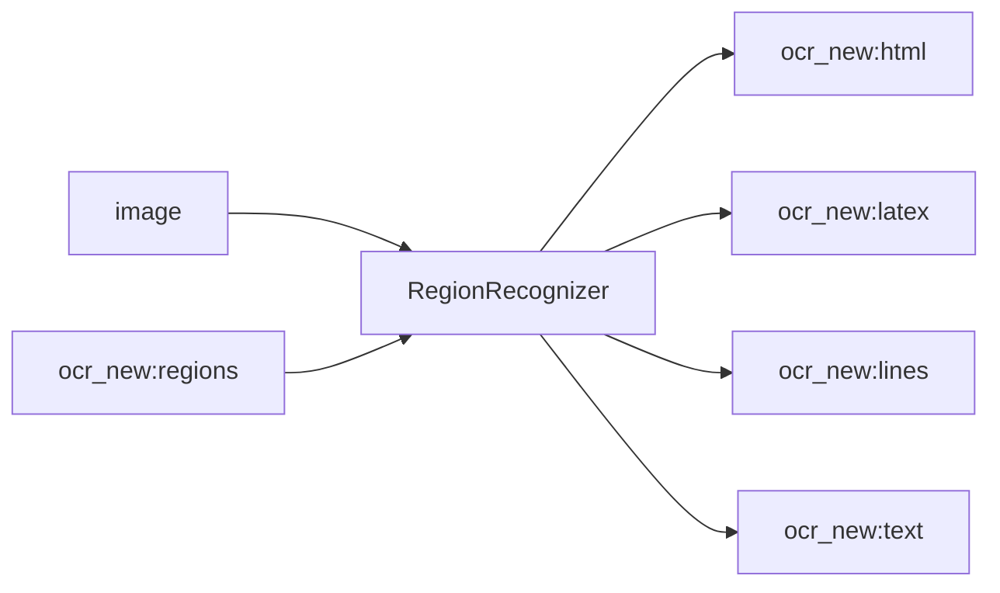

<!-- Generated by `linecaster docs`: edit the code, the docstrings or the catalog, not this file. -->
# RegionRecognizer

*Block · recognition · `linecaster.blocks.recognition`*

Recognizes each layout region of every page with a chat VLM, one request per region crop.

|  |  |
|---|---|
| Unit | page |
| Role | model |
| Reads | `image`, `ocr_new:regions` |
| Adds | `ocr_new:html`, `ocr_new:latex`, `ocr_new:lines`, `ocr_new:text` |
| Replaces | - |
| Backends | chat (`Chat`), a preset ref (`id@edition`) builds one |
| Catalog step | `recognition` |
| Presets | [`lightonocr-2-1b-regions@1`](../../catalog/presets/recognition/lightonocr-2-1b-regions.md), [`minicpm-ocr-1.0@1`](../../catalog/presets/recognition/minicpm-ocr-1.0.md) |
| Comes after | any reader, [`LayoutDetector`](../layout/LayoutDetector.md), [`ModularTranscriber`](../composites/ModularTranscriber.md) |
| Comes before | [`LineAssigner`](../lines/LineAssigner.md), [`LineRecognizer`](LineRecognizer.md), [`CharacterNormalizer`](../text/CharacterNormalizer.md), [`UnicodeNormalizer`](../text/UnicodeNormalizer.md), [`Composer`](../composition/Composer.md), [`Recomposer`](../composition/Recomposer.md), [`Typographer`](../composition/Typographer.md), [`ItemTextWriter`](../writers/ItemTextWriter.md), [`PageFileWriter`](../writers/PageFileWriter.md) |
| Used in | [`transcribe_vlm.v1`](../../catalog/pipelines/transcribe_vlm.v1.md) |
| Source | [chat.py](https://github.com/storytracer/linecaster/blob/main/src/linecaster/blocks/recognition/chat.py) |

The contract is that of `RegionRecognizer(backend='minicpm-ocr-1.0@1')`; the comes-after and comes-before rows are derived from every block's contract.

## Options

| Option | Type | Default | Description |
|---|---|---|---|
| `backend` | `Chat \| str` | required | a `Chat` backend, or a chat preset's ref (a model's Hugging Face id picks its region preset) for one on the task's `ChatModelServer`; any other backend is refused (`PipelineConfigError`). |
| `transcription` | `str` | `'ocr_new'` | the transcription it reads the regions of and adds the lines to. |
| `labels` |  | `frozenset({'caption', 'code', 'footnote', 'list_item', 'page_footer', 'page_header', 'reference', 'section_header', 'table', 'text', 'title'})` | the region labels it reads (default: text-like regions and tables, no pictures or formulas). |
| `pad` | `int` | `8` | pixels around each region's box at the page scale; an adapter with a `region_pad` of its own uses that instead. |
| `primary` | `str \| None` | `None` | the transcription whose text becomes the datatrove document's `text`; `None`: `transcription`. |
| `skip_on_error` | `bool` | `True` | pass pages that carry errors through unprocessed. |
| `prepare_workers` | `int` | `4` | threads that build the requests (crops, PNG encoding) ahead of admission. |

## Behavior

The same saturate machinery as `PageRecognizer`, results collected per page; any layout step can come
before it. Reads the page image and `regions`; adds `lines`, `text` and what the preset produces.
Crops are cut at the scale the model expects for a whole page (the adapter's `page_longest`: the page is
scaled so its longest side has that length, and the region is cut from it, `pad` px around the region's box
at that scale), so a small region is not blown up; the adapter decides which regions it reads. Every read
region gets one line: the region's box and polygon, the completion as its text (verbatim; `extra` keeps
`raw` and `finish_reason`), in reading order; the transcription's earlier lines are replaced. The
`StepInfo` records the preset edition, the settings with `pad`, `page_scale` and `labels`, and the
token counts, `regions` and `failed`. A page whose regions all failed is the page's error; a page without
readable regions passes through unchanged (stat `pages_without_regions`).

## Contract



## Example

```python
RegionRecognizer("minicpm-ocr-1.0@1")
```
