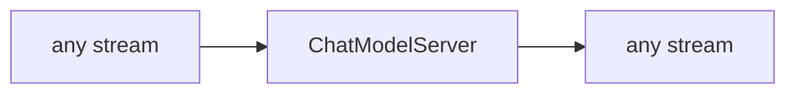

<!-- Generated by `linecaster docs`: edit the code, the docstrings or the catalog, not this file. -->
# ChatModelServer

*Block · servers · `linecaster.blocks.servers`*

Starts a chat VLM server (vLLM or SGLang) inside the task for its `Chat` backends, through saturate's `Engine`.

|  |  |
|---|---|
| Unit | any |
| Role | server |
| Reads | - |
| Adds | - |
| Replaces | - |
| Comes after | - |
| Comes before | - |
| Used in | [`transcribe_vlm.v1`](../../catalog/pipelines/transcribe_vlm.v1.md) |
| Source | [serve.py](https://github.com/storytracer/linecaster/blob/main/src/linecaster/blocks/servers/serve.py) |

The contract is that of `ChatModelServer(spec='lightonocr-2-1b@1')`; the comes-after and comes-before rows are derived from every block's contract.

## Options

| Option | Type | Default | Description |
|---|---|---|---|
| `spec` |  | required | the chat preset's adapter (`linecaster.adapters.chat_model`) or the preset's ref (`id@edition`). |
| `port` | `int` | `8000` | the port the server listens on; `Chat` without an endpoint asks on 8000. |
| `host` | `str` | `'127.0.0.1'` | the address the server binds to; default loopback only. |
| `gpu_memory_utilization` | `float \| None` | `None` | the share of GPU memory the server may take (for SGLang `--mem-fraction-static`); default the preset's flags alone. The deployment's choice. |
| `extra_args` | `list[str] \| None` | `None` | more server flags, after the preset's. |
| `vllm` | `str` | `'vllm'` | the vLLM command (default `vllm` on `PATH`, e.g. from the job image or a `uv run --with vllm==...` environment). |
| `boot_timeout` | `int` | `1800` | seconds the server may take to answer. |
| `outside_venv` | `bool` | `False` | start the server without this interpreter's virtual environment (`VIRTUAL_ENV` unset, its `bin` taken off `PATH`), for a job image whose own Python has the server while the pipeline runs in a uv environment on top (HF Jobs); the server's helpers (`ninja`, `python`) then come from the image. |
| `python` | `str` | `'python3'` | the Python that has SGLang (default `python3`, looked up on the server's `PATH`, then in the usual image locations). |

## Behavior

The command comes from the chat preset's `serve` block (server, flags, environment, packages), whose `server`
picks it:

* `"vllm"`: `vllm serve <spec.model> --host HOST --port PORT <spec.vllm_args(...)>` (behind `bash -c` when
  the preset has a setup script);
* `"sglang"`: `PYTHON -m sglang.launch_server --model-path <spec.model> --host HOST --port PORT
  --enable-metrics <spec.sglang_args(...)>` (metrics on: saturate reads SGLang's queue gauges).

The server starts in `warm_up()` and is ready when it answers a trial chat request (saturate's alive-only
gate); it stops when the task's pages are through. Before it starts, the preset's `server_packages` are
installed into the server's Python (`uv pip install --python <that Python> ...`), and for a preset with
`revision_flag: false` (the server cannot be given `--revision` and loads the default branch) the block
refuses to start unless the default branch's files equal the pinned revision's (`check_default_branch`); the
preset's `server_env` goes into the server's environment. With OTLP configured, vLLM traces too
(`tracing_args`). A server that does not start fails the task (`ServerError`).

Its role is `server` and its unit `any`: it touches no part. Like `ModelServer`, it goes **last** in the
pipeline (after the writer): datatrove chains generators, and only the last one lives until every page is
written.

## Contract

