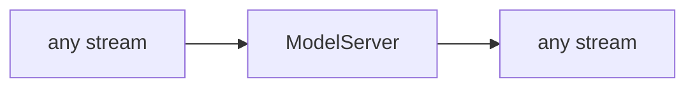

<!-- Generated by `linecaster docs`: edit the code, the docstrings or the catalog, not this file. -->
# ModelServer

*Block · servers · `linecaster.blocks.servers`*

Starts `linecaster serve` inside the task for its served model blocks, through saturate's `Engine`.

|  |  |
|---|---|
| Unit | any |
| Role | server |
| Reads | - |
| Adds | - |
| Replaces | - |
| Comes after | - |
| Comes before | - |
| Used in | - |
| Source | [serve.py](https://github.com/storytracer/linecaster/blob/main/src/linecaster/blocks/servers/serve.py) |

The contract is that of `ModelServer(models=[])`; the comes-after and comes-before rows are derived from every block's contract.

## Options

| Option | Type | Default | Description |
|---|---|---|---|
| `models` | `list[dict]` | required | the models to host, one dict each: `{"name", "preset"}` (a catalog preset, optional `"overrides"` over its options) or `{"name", "spec", "kwargs"}` (an engine class `module:Class`). A served model block asks for its model by `name`. |
| `port` | `int` | `8100` | the port the server listens on (loopback). |
| `python` | `str \| None` | `None` | the Python that runs `linecaster serve -m linecaster.cli`; default this interpreter. Ignored with `script`. |
| `boot_timeout` | `int` | `1800` | seconds the server may take until every model is loaded. |
| `max_queue` | `int` | `16` | requests a model accepts before answering 429. |
| `script` | `str \| None` | `None` | a pipeline script whose `serve` command starts the server in the script's own environment (`uv run --script <script> serve`); default: `python`. |

## Behavior

The server starts in `warm_up()` and is ready when every model is loaded; it stops when the task's pages are
through. Its environment carries what the observers ask for (the task's trace file). A server that does not
start fails the task (`ServerError`). Its role is `server` and its unit `any`: it touches no part. It goes
**last** in the pipeline (after the writer): datatrove chains generators, and only the last one lives until every
page is written.

## Contract

