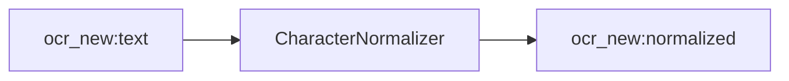

<!-- Generated by `linecaster docs`: edit the code, the docstrings or the catalog, not this file. -->
# CharacterNormalizer

*Block · text · `linecaster.blocks.text`*

Normalizes the texts of every line, paragraph and table cell by a normalization engine, next to the text as written.

|  |  |
|---|---|
| Unit | page |
| Role | transform |
| Reads | `ocr_new:text` |
| Adds | `ocr_new:normalized` |
| Replaces | - |
| Backends | in-process only (a built-in engine) |
| Catalog step | `normalization` |
| Presets | [`latin-historic@1`](../../catalog/presets/normalization/latin-historic.md) |
| Comes after | [`LineRecognizer`](../recognition/LineRecognizer.md), [`PageRecognizer`](../recognition/PageRecognizer.md), [`RegionRecognizer`](../recognition/RegionRecognizer.md), [`ModularTranscriber`](../composites/ModularTranscriber.md) |
| Comes before | [`ItemTextWriter`](../writers/ItemTextWriter.md) |
| Used in | [`bind.v1`](../../catalog/pipelines/bind.v1.md), [`transcribe_modular.v1`](../../catalog/pipelines/transcribe_modular.v1.md) |
| Source | [normalizer.py](https://github.com/storytracer/linecaster/blob/main/src/linecaster/blocks/text/normalizer.py) |

The contract is that of `CharacterNormalizer(preset='latin-historic@1')`; the comes-after and comes-before rows are derived from every block's contract.

## Options

| Option | Type | Default | Description |
|---|---|---|---|
| `preset` |  | required | the normalization engine: a preset (e.g. `latin-historic@1`) or an `InProcess` engine spec. |
| `transcription` | `str` | `'ocr_new'` | the transcription to normalize. |
| `unit` | `str` | `'page'` | `page` (a stream of pages) or `item` (a stream of item records, after a `Binder`). |
| `options` | `dict[str, Any] \| None` | `None` | engine options over the preset's; `None`: the preset's. |

## Behavior

Character fidelity *as written* -> *normalized*: each gets its `normalized` (`Line.normalized`,
`Paragraph.normalized`, the table cells' `normalized`); the as-written texts are never touched. After a
`Recomposer` the paragraphs are normalized too. Reads `text`; adds `normalized`; stat `changed`.
`unit="page"`: each page; `unit="item"`: each page of an item record (`linecaster.blocks.base.item`),
after an item-level `Recomposer`.

## Contract



## Example

```python
CharacterNormalizer("latin-historic@1", unit="item")
```
