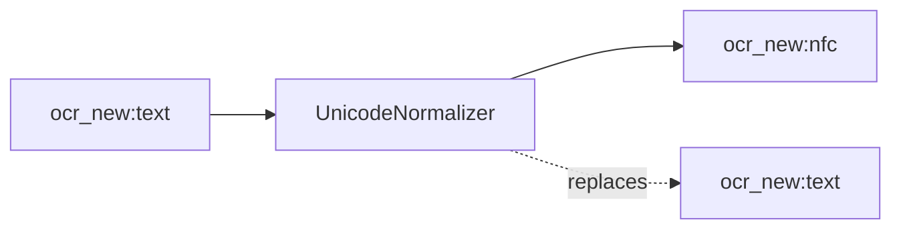

<!-- Generated by `linecaster docs`: edit the code, the docstrings or the catalog, not this file. -->
# UnicodeNormalizer

*Block · text · `linecaster.blocks.text`*

Normalizes the as-written text of every line and word to one Unicode normalization form, NFC by default.

|  |  |
|---|---|
| Unit | page |
| Role | transform |
| Reads | `ocr_new:text` |
| Adds | `ocr_new:nfc` |
| Replaces | `ocr_new:text` |
| Comes after | [`LineRecognizer`](../recognition/LineRecognizer.md), [`PageRecognizer`](../recognition/PageRecognizer.md), [`RegionRecognizer`](../recognition/RegionRecognizer.md), [`ModularTranscriber`](../composites/ModularTranscriber.md) |
| Comes before | - |
| Used in | [`transcribe_modular.v1`](../../catalog/pipelines/transcribe_modular.v1.md) |
| Source | [unicode.py](https://github.com/storytracer/linecaster/blob/main/src/linecaster/blocks/text/unicode.py) |

The comes-after and comes-before rows are derived from every block's contract.

## Options

| Option | Type | Default | Description |
|---|---|---|---|
| `transcription` | `str` | `'ocr_new'` | the transcription to normalize; also the datatrove document's `text`. |
| `form` | `str` | `'NFC'` | `NFC` or `NFD`; any other form is refused (`PipelineConfigError`). |

## Behavior

Right after recognition (`linecaster.text.unicode` says why it is a step of its own): canonical equivalence
only, never a compatibility form (NFKC folding belongs to the readable text variants). Reads `text`; adds
`nfc`; replaces `text` (in place). A page without the transcription passes unchanged; stat
`strings_changed` counts the strings that changed.

## Contract

