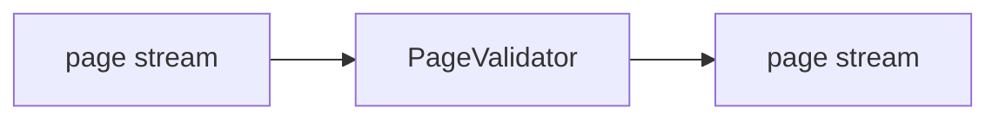

<!-- Generated by `linecaster docs`: edit the code, the docstrings or the catalog, not this file. -->
# PageValidator

*Block · validation · `linecaster.blocks.validation`*

Marks the page records that do not validate against `Page` or lack a required part with an error each.

|  |  |
|---|---|
| Unit | page |
| Role | validator |
| Reads | - |
| Adds | - |
| Replaces | - |
| Comes after | - |
| Comes before | - |
| Used in | - |
| Source | [pages.py](https://github.com/storytracer/linecaster/blob/main/src/linecaster/blocks/validation/pages.py) |

The comes-after and comes-before rows are derived from every block's contract.

## Options

| Option | Type | Default | Description |
|---|---|---|---|
| `required` | `tuple[str, ...]` | `()` | what each page must have: a page field (`"image"`, `"item_id"`, ...: not empty) or a transcription (`"transcriptions.<name>"`); default: nothing beyond a valid page record. |

## Behavior

The error entry (`doc.metadata["errors"]`) names the failing location as `field` and the offending input as
`raw_value` (type `invalid`, or `missing` for a required part); later model blocks pass such a page by and
the `RejectWriter` writes it to `rejects/`. It reads what it requires. Every page goes on.

## Contract

