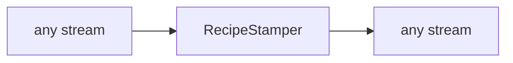

<!-- Generated by `linecaster docs`: edit the code, the docstrings or the catalog, not this file. -->
# RecipeStamper

*Block · validation · `linecaster.blocks.validation`*

Stamps the recipe edition a run follows on every step of every transcription, of a page or of each page of an item record.

|  |  |
|---|---|
| Unit | any |
| Role | transform |
| Reads | - |
| Adds | - |
| Replaces | - |
| Comes after | - |
| Comes before | - |
| Used in | - |
| Source | [recipe.py](https://github.com/storytracer/linecaster/blob/main/src/linecaster/blocks/validation/recipe.py) |

The contract is that of `RecipeStamper(recipe='squiddle@1', recipe_sha256='sha256:0000000000000000000000000000000000000000000000000000000000000000')`; the comes-after and comes-before rows are derived from every block's contract.

## Options

| Option | Type | Default | Description |
|---|---|---|---|
| `recipe` | `str` | required | the recipe edition, `id@edition`. |
| `recipe_sha256` | `str` | required | that edition's hash (`sha256:<hex>`). |

## Behavior

It sets `StepInfo.recipe` and `StepInfo.recipe_sha256` and adds no part (unit `any`: pages or item
records). The builder puts one before the first writer when a run follows a recipe.

## Contract

