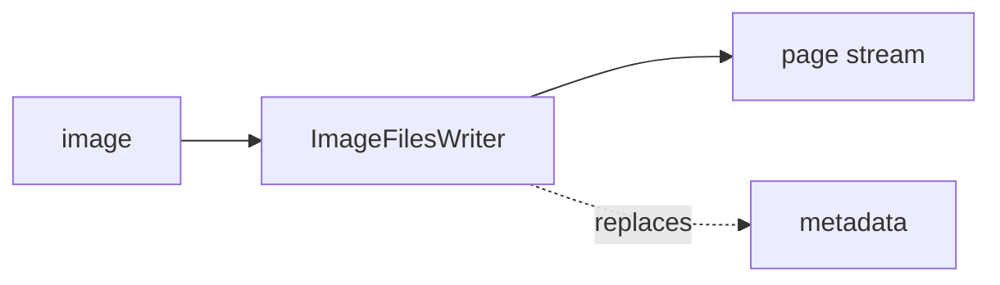

<!-- Generated by `linecaster docs`: edit the code, the docstrings or the catalog, not this file. -->
# ImageFilesWriter

*Block · writers · `linecaster.blocks.writers`*

Writes each page's image bytes as they came, one file per page.

|  |  |
|---|---|
| Unit | page |
| Role | writer |
| Reads | `image` |
| Adds | - |
| Replaces | `metadata` |
| Comes after | any reader |
| Comes before | - |
| Used in | [`harvest.v1`](../../catalog/pipelines/harvest.v1.md) |
| Source | [images.py](https://github.com/storytracer/linecaster/blob/main/src/linecaster/blocks/writers/images.py) |

The contract is that of `ImageFilesWriter(output_folder='out/images')`; the comes-after and comes-before rows are derived from every block's contract.

## Options

| Option | Type | Default | Description |
|---|---|---|---|
| `output_folder` | `DataFolderLike` | required | the folder (local path, fsspec URI or `DataFolder`) the images go to. |
| `ocr_folder` | `DataFolderLike \| None` | `None` | where a library's own OCR that came with the page (a document media, as `ManifestReader`'s `existing_ocr` adds it) is written the same way, `<ocr_folder>/<item_id>/<page_id>.xml` (ALTO) or `.html` (hOCR), when the page has its `ocr_original` transcription; that transcription's `source.extra["file"]` then names the copy. Default: not written. |

## Behavior

Files go to `<output_folder>/<item_id>/<page_id>.<ext>` (any fsspec folder; `<page_id>.<ext>` for pages
without an item), the extension from the image's format. It reads `image` and replaces `metadata`: the page's
`image.uri` then names the written file and `image.extra["source_uri"]` where it came from, so page records written after this block
point at the copy (`PageRecordReader` fetches it from there), and `ImageFolderReader(output_folder,
item_from_parent=True)` reads the folder as it is. Pages pass through; a page that carries errors and no image
(e.g. its download failed) passes through unchanged, with no file written; a page read from the file an earlier
launch wrote (`image.extra["reused"]`, a reader's `reuse_folder`) gets its record as written, the file
left as it is. A local file appears only once it is whole
(written as `<name>.part`, then renamed), so a reader never takes a half-written file for a done page.

## Contract

