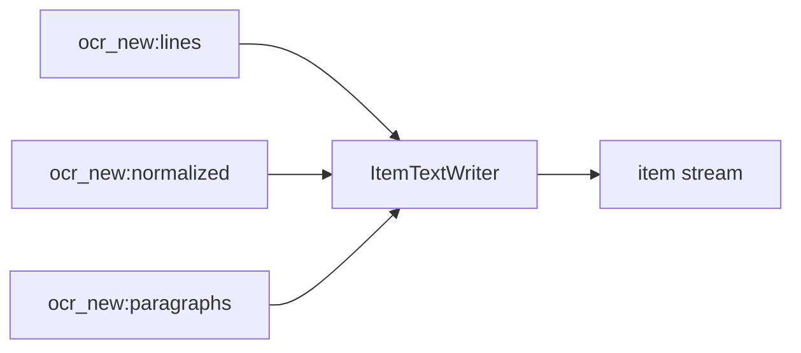

<!-- Generated by `linecaster docs`: edit the code, the docstrings or the catalog, not this file. -->
# ItemTextWriter

*Block · writers · `linecaster.blocks.writers`*

Writes the text variants of each item record as JSON Lines or as files.

|  |  |
|---|---|
| Unit | item |
| Role | writer |
| Reads | `ocr_new:lines`, `ocr_new:normalized`, `ocr_new:paragraphs` |
| Adds | - |
| Replaces | - |
| Comes after | [`LineDetector`](../lines/LineDetector.md), [`RegionRecognizer`](../recognition/RegionRecognizer.md), [`CharacterNormalizer`](../text/CharacterNormalizer.md), [`Recomposer`](../composition/Recomposer.md), [`ModularTranscriber`](../composites/ModularTranscriber.md) |
| Comes before | - |
| Used in | [`bind.v1`](../../catalog/pipelines/bind.v1.md), [`transcribe_modular.v1`](../../catalog/pipelines/transcribe_modular.v1.md) |
| Source | [items.py](https://github.com/storytracer/linecaster/blob/main/src/linecaster/blocks/writers/items.py) |

The contract is that of `ItemTextWriter(output_folder='out/texts')`; the comes-after and comes-before rows are derived from every block's contract.

## Options

| Option | Type | Default | Description |
|---|---|---|---|
| `output_folder` | `DataFolderLike` | required | the folder (local path, fsspec URI or `DataFolder`) the texts go to. |
| `format` | `str` | `'jsonl'` | `jsonl` (one folder per variant, `<variant>/<rank>.jsonl.gz`) or `files` (one file per item and variant, `<variant>/<item_id>.<txt\|md>`). |
| `variants` | `tuple[str, ...]` | `('verbatim_txt', 'readable_txt', 'readable_md')` | the variants to write, names of `VARIANTS`; an unknown one is a `PipelineConfigError`. |
| `transcription` | `str` | `'ocr_new'` | the transcription the texts are made from. |
| `token_counter` | `Callable[[str], int] \| None` | `None` | counts a text's tokens for `token_count` (e.g. the length of a tiktoken encoding's `encode`); default: no count. |
| `output_filename` | `str` | `'${variant}/${rank}.jsonl.gz'` | the JSON Lines file name (`jsonl`), datatrove's template. |
| `**kwargs` |  |  | datatrove's `JsonlWriter` arguments (`compression`, `max_file_size`, ...). |

## Behavior

The variants (`linecaster.text.variants`): `verbatim_txt` from its pages' lines as laid out (pages joined
with a form feed; reads `lines`), `readable_txt` and `readable_md` from the paragraphs of the item's
recomposition (`Recomposer(unit="item")`), normalized (`CharacterNormalizer`), body only (reads
`paragraphs` and `normalized`). A JSON Lines row per item and variant holds `id` (the item), `text` and
`item_id`, `variant`, `fidelity`, `flow`, `scope`, `format`, `page_ids`, `pages` (count) and
`token_count` with a `token_counter`. A stream entry that is no item record is counted (`no_item`). Item
records pass through.

## Contract

