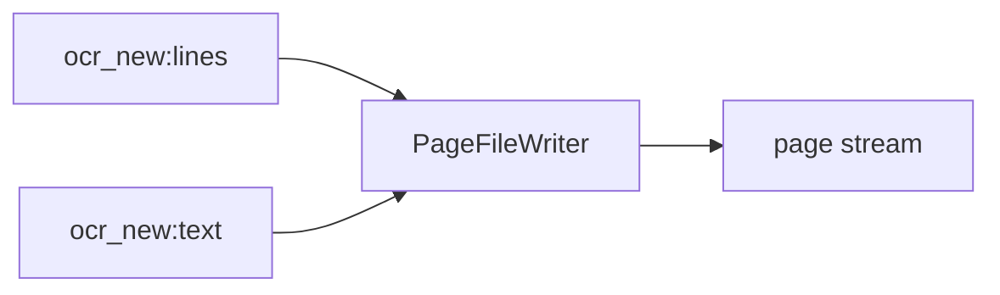

<!-- Generated by `linecaster docs`: edit the code, the docstrings or the catalog, not this file. -->
# PageFileWriter

*Block · writers · `linecaster.blocks.writers`*

Writes one file per page and format: ALTO, PAGE-XML, hOCR, text, Markdown, HTML, DocLang, JSON and more.

|  |  |
|---|---|
| Unit | page |
| Role | writer |
| Reads | `ocr_new:lines`, `ocr_new:text` |
| Adds | - |
| Replaces | - |
| Comes after | [`LineDetector`](../lines/LineDetector.md), [`LineRecognizer`](../recognition/LineRecognizer.md), [`PageRecognizer`](../recognition/PageRecognizer.md), [`RegionRecognizer`](../recognition/RegionRecognizer.md), [`ModularTranscriber`](../composites/ModularTranscriber.md) |
| Comes before | - |
| Used in | [`transcribe_modular.v1`](../../catalog/pipelines/transcribe_modular.v1.md) |
| Source | [files.py](https://github.com/storytracer/linecaster/blob/main/src/linecaster/blocks/writers/files.py) |

The contract is that of `PageFileWriter(output_folder='out/files')`; the comes-after and comes-before rows are derived from every block's contract.

## Options

| Option | Type | Default | Description |
|---|---|---|---|
| `output_folder` | `DataFolderLike` | required | the folder (local path, fsspec URI or `DataFolder`) the files go to. |
| `formats` | `tuple[str, ...]` | `('hocr', 'alto', 'page', 'txt')` | the formats to write, keys of `PAGE_FILE_EXTENSIONS`; an unknown one is a `PipelineConfigError`. |
| `transcription` | `str` | `'ocr_new'` | the transcription written. |
| `suffix` | `str` | `''` | added to each file's stem, before the extension (squiddleocr's names use `".paddle"`). |
| `furniture` | `bool` | `False` | keep page headers and footers in md, txt and html. |
| `bucket_by_item` | `bool` | `True` | one folder per item; `False` writes `<page_id><suffix>.<ext>` flat, as squiddleocr names its files. Pages without `item_id` are always written flat. |
| `detail` | `str` | `'word'` | `word` (lines and words) or `line` (text per line) for hOCR, ALTO and PAGE. |
| `dividers` | `bool` | `False` | put `---` between layout regions in md. |
| `text_fallback` | `bool` | `True` | a page without a document still gets md and txt from `Transcription.text`; `False` writes them only from a document (the block then reads `document`). |

## Behavior

Files go to `<output_folder>/<item_id>/<page_id><suffix>.<ext>` (any fsspec folder: local, `s3://`,
`hf://buckets/...`). It reads the parts its formats are written from (`FORMAT_PARTS`: `lines` for hOCR,
ALTO and PAGE, `text` for md and txt, `document` for HTML, DocLang and JSON, `image` for plots) and adds
nothing; pages pass through, so writers can be chained. A page without the transcription is counted
(`no_transcription`) and passed on.

* `hocr`, `alto`, `page`: linecaster's serializers (`to_hocr`/`to_alto`/`to_page`) at the
  page image's size; `detail="line"` leaves the words out (text per line);
* `md`, `txt`, `html`, `doclang`, `json`: the DoclingDocument's exports
  (`linecaster.formats.docling.export`) when the transcription has one (`Composer`); without one, md and
  txt fall back to `Transcription.text` (lines in reading order, tables as Markdown/HTML; counted as
  `<format>_from_page_text`) and the others are skipped (counted as `no_document`);
* `transcription`: the `Transcription` itself as JSON;
* `plot`: a JPEG of the page image with the regions and lines drawn in (`linecaster.images.plots`).

## Contract

