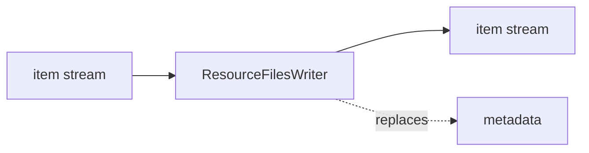

<!-- Generated by `linecaster docs`: edit the code, the docstrings or the catalog, not this file. -->
# ResourceFilesWriter

*Block · writers · `linecaster.blocks.writers`*

Writes each resource's bytes as they came, one file per resource.

|  |  |
|---|---|
| Unit | item |
| Role | writer |
| Reads | - |
| Adds | - |
| Replaces | `metadata` |
| Comes after | - |
| Comes before | - |
| Used in | [`harvest.v1`](../../catalog/pipelines/harvest.v1.md) |
| Source | [resources.py](https://github.com/storytracer/linecaster/blob/main/src/linecaster/blocks/writers/resources.py) |

The contract is that of `ResourceFilesWriter(output_folder='out')`; the comes-after and comes-before rows are derived from every block's contract.

## Options

| Option | Type | Default | Description |
|---|---|---|---|
| `output_folder` | `DataFolderLike` | required | the folder (local path, fsspec URI or `DataFolder`) the copies go to (the run folder). |

## Behavior

Files go to `<output_folder>/<kind>/<item>/<name>.<ext>` (any fsspec folder), appearing only once whole (a
local file as `<name>.part`, then renamed); a resource read back from its copy (`reused`) is not written again.
The record's `uri` then names the copy, its `source_uri` where it came from. A resource that failed (no
bytes) passes through without a file.

## Contract

