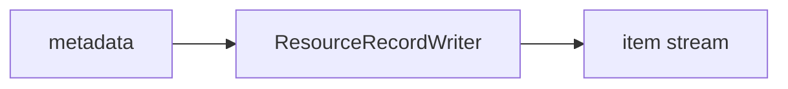

<!-- Generated by `linecaster docs`: edit the code, the docstrings or the catalog, not this file. -->
# ResourceRecordWriter

*Block · writers · `linecaster.blocks.writers`*

Writes each resource's record (`doc.metadata["resource"]`, with its errors) as a JSON line, to `<output_folder>/<rank>.jsonl.gz`: one file per task, a failed resource included (`error`, `errors`).

|  |  |
|---|---|
| Unit | item |
| Role | writer |
| Reads | `metadata` |
| Adds | - |
| Replaces | - |
| Comes after | any reader |
| Comes before | - |
| Used in | [`harvest.v1`](../../catalog/pipelines/harvest.v1.md) |
| Source | [resources.py](https://github.com/storytracer/linecaster/blob/main/src/linecaster/blocks/writers/resources.py) |

The contract is that of `ResourceRecordWriter(output_folder='out/resources')`; the comes-after and comes-before rows are derived from every block's contract.

## Options

| Option | Type | Default | Description |
|---|---|---|---|
| `output_folder` | `DataFolderLike` | required | the folder (local path, fsspec URI or `DataFolder`) of the records (`OUT/resources`). |

## Contract

