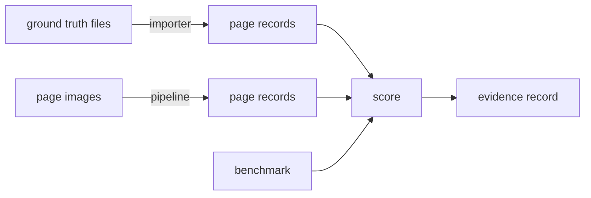

# Evaluation

## The parts

| Part | What it is |
|---|---|
| ground truth | transcriptions made or checked by people, as page records |
| benchmark | a definition of how to score against one ground truth: which pages, which lanes, which metrics |
| score record | one page's counts for one lane |
| evidence record | the result of scoring one run, with everything needed to compare it with another |

## How scoring works

1. An **importer** reads the ground truth (ALTO, PAGE-XML, hOCR, TEI, HTML, plain text) into page records.
2. A pipeline transcribes the same pages.
3. Both sides are rendered the same way and normalized by the same **lane**.
4. The scorer counts character and word errors for the page, and for each region, table and formula on its own.

Rates are computed from counts, so results can be added up across pages without bias.

## What linecaster does not hold

Linecaster ships the scorer and the formats. Ground truths, benchmarks and results are data: they live in the
repository of the evaluation that made them, not in linecaster.

## Reference

[Evaluation](../reference/evaluation.md) defines the lanes, the metrics and the record formats.
