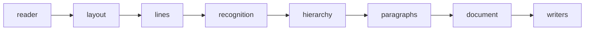
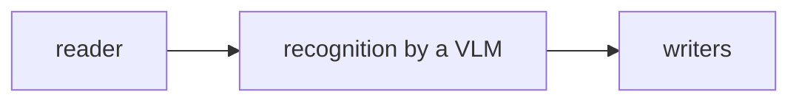

# Overview

Linecaster turns page images into text. This page explains its few main ideas and how they fit together. Each idea
has a page of its own, and the [glossary](../reference/glossary.md) lists every term.

## A pipeline of components

A **pipeline** is an ordered list of **components**. Pages go through it one after another, and each component
reads a page and adds something to it.

This is the modular pipeline: a layout model finds the regions of a page, a line detector finds the lines, and a
line recognizer reads each line. Rule-based components then find the headings, join the lines into paragraphs and
build a document. A second kind of pipeline is shorter: a vision-language model reads the whole page in one go.

Each box is a **step**: one kind of work. What does the work at a step is your choice.

Read more: [components and pipelines](pipelines.md).

## Models, engines and presets

Three things work together at a step:

- A **model** is a file of weights from upstream, pinned to an exact revision.
- An **engine** is the code that loads a model and runs it. Rule-based engines need no model.
- A **preset** is a named configuration of one engine with one model. A preset is what you pick:
  `--recognition kraken-ppocrv6-medium`.

A **recipe** is a tested combination of presets, one for each step. All of these are listed in the **catalog**.

Read more: [models, engines and presets](models.md).

## The page record

A pipeline's result is one **page record** per page. It holds everything every component said about the page: the
regions, the lines, the text of each line, the tables, and who said it. Nothing in it is overwritten.

The text in the record is exactly what the model read. Changes such as joining hyphenated words are made only when
you ask for a text to be written, by a **strategy** you name.

Read more: [page records](page-records.md) and [text and normalization](text.md).

## Running anywhere

Linecaster builds on [datatrove](https://github.com/huggingface/datatrove), which runs a pipeline on a laptop, on
a Ray cluster or on Hugging Face Jobs. The pipeline stays the same; only the command line changes. A run can be
interrupted and resumed, and a page that fails is set aside with the reason.

## Ground truth and scoring

Linecaster also reads **ground truth** (transcriptions made by people) in many formats into the same page records,
and scores a run against it.

Read more: [evaluation](evaluation.md).

## Where to go next

- [Run a vision-language model](../start/vlm.md): one model reads the page.
- [Combine models step by step](../start/first-run.md): a model for each step, on the command line.
- [A pipeline in Python](../start/python.md).
- [Score a run against ground truth](../start/score.md).
