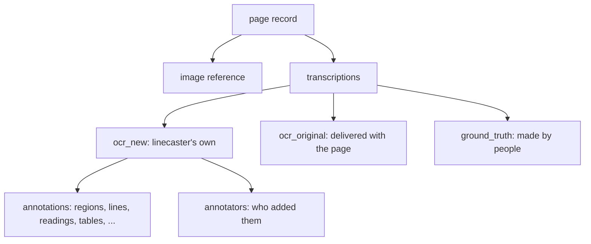

# Page records

A page record holds everything a pipeline found on one page, and which component found it.

## Items and pages

An **item** is an ordered set of pages: a book, a newspaper issue, a PDF, a folder of images. A **page** is one
page of an item, with its image.

## What a page record holds

A page record is the page as it goes through a pipeline and as it is stored. Each component adds to it:

A **transcription** is everything one source said about the page. A page can have several, side by side.

Each thing a source said is an **annotation**: a region, a line, the reading of a line, a table. An annotation
names its **annotator**: the engine, the preset and the linecaster version that made it. Annotations are added,
never changed.

## Why it is built this way

- You can always see who said what. If two engines disagree, both statements are in the record.
- Nothing is lost. The raw answer of a model is kept next to what was parsed from it.
- One format serves everything: OCR output, a library's delivered OCR and ground truth all use it, so they can be
  compared.

## Where records are stored

A run writes its page records to `OUT/pages/`, as JSON Lines or Parquet. Other pipelines read them from there
with `--pages OUT/pages`.

## Renderings

ALTO, PAGE-XML, hOCR, Markdown, HTML and plain text are written from a page record when you ask for them
(`--files DIR --formats md,alto`). They are **renderings**: outputs, never the stored truth.

## Reference

The [data model](../reference/data-model.md) lists every field. [Serialization](../reference/serialization.md)
describes each output format.
